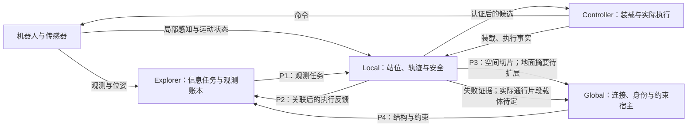
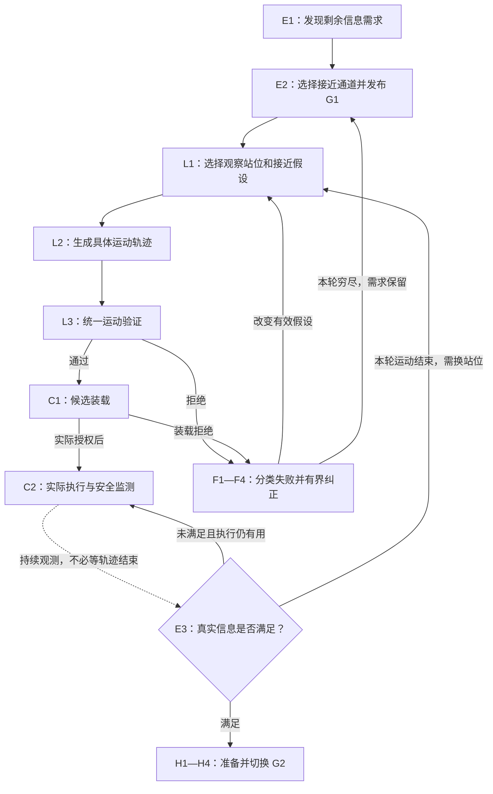
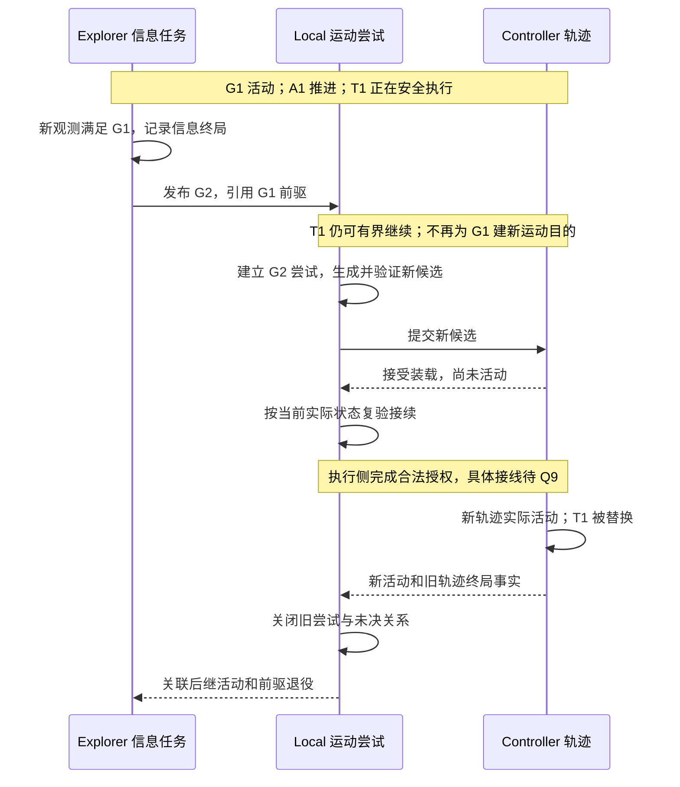
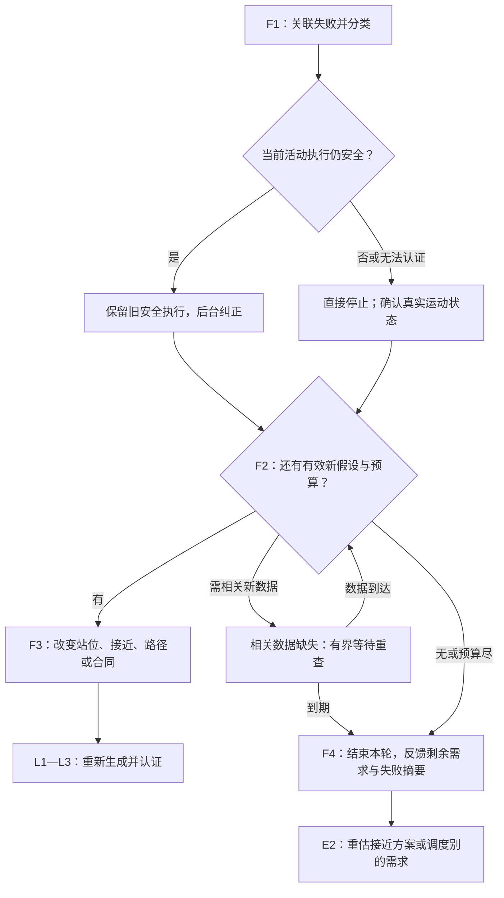
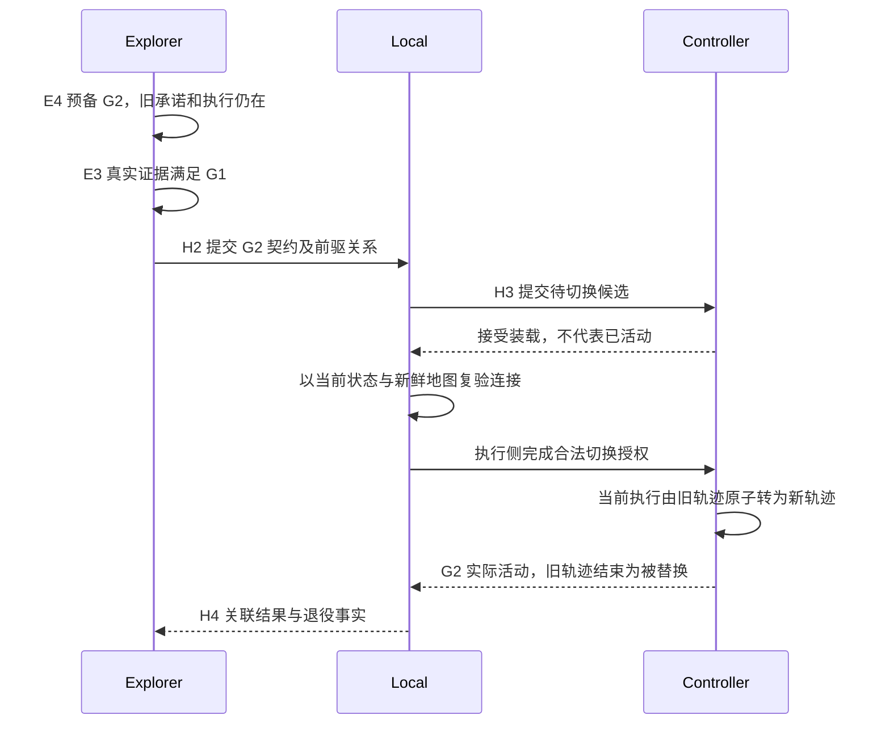
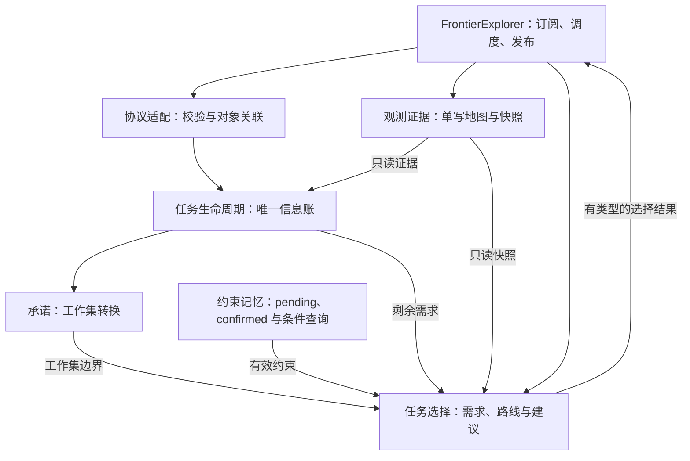

# SCAN-Planner 契约栈设计蓝图

版本：蓝图 v1.4，2026-10-09。在 v1.3 的 Node／Edge、地形摘要与经验回流设计基础上，补充出发连接、终端站位和中段绕障的具体求解过程；明确允许下调偏大的旧包络，统一机体模型与误差预算，并登记必须退役的重复限制。原流程卡片编号保持不变。责任边界和本轮决定单独标明；求解细节仍按推荐设计、接口草案或待决记录，不代表代码已经实现。

本文是设计审查与后续实现的主阅读入口，按运行过程组织。原 v3.4 规格及过程稿保留为设计来源；本文中的修订和待定项显式列出，不把建议写成已经实现的能力。

## 0. 阅读入口：怎样用这份蓝图审核系统

这份文件首先是一张可以下钻的流程地图，其次才是说明书。先读系统总图，接着沿正常任务走一遍；遇到不理解的判断，就按节点编号进入审核卡片。卡片告诉你是谁做决定、依据是什么、改变哪个对象，以及每个出口通往哪里。

编号不是新增的 FSM 状态，也不要求一个编号对应一个类。E 表示 Explorer 的判断，L 表示 Local 的规划，C 表示 Controller 的执行，F 表示失败处理，H 表示交接，G 表示结构维护，N 表示约束，X 表示取消与恢复。编号一经使用不重新编号；流程改变时保留变更说明。

你可以直接提问：“L3 为什么拒绝这个方案？”“F2 怎样判断这次不是重复走法？”“H3 的切换条件为什么需要这一项？”回答应当修改对应卡片及其相关接口和测试，而不是另写一篇互不关联的说明。

第一次了解系统，可以先读 [对外讲解与评审简版](CONTRACT_STACK_OVERVIEW_ZH.md)，再读本文第 2 章和 [3.6—3.15 生命周期展开](#lifecycles)。简版解释为什么这样做，本文解释每一步到底怎么做。简版不另立规则；设计修改以本文对应卡片为准。

文中的状态标记含义如下。

| 标记 | 含义 |
|---|---|
| 边界已定 | 来自现有规格和讨论的责任边界，后续实现不能悄悄违反 |
| 推荐设计 | 本蓝图提出的具体做法，仍可在审核中修改 |
| 接口草案 | 语义需求清楚，但消息字段、函数签名或接线尚未冻结 |
| 待决 Q… | 需要明确设计选择或实验才能决定，不能当成默认实现 |
| 代码现状 | 当前文件中可以定位到的行为或资产，不代表整条新链已经完成 |

### 0.1 导航目录

| 你现在想审核什么 | 阅读入口 |
|---|---|
| 整个系统为什么这样分层 | [1. 任务和总图](#system) |
| 一次探索从哪开始、怎么结束 | [2. 正常任务主线](#normal) |
| 什么对象可以独立结束，ID 怎么用 | [3. 对象和生命周期](#objects) |
| 想用实际例子理解对象怎样开始、等待、结束 | [3.6 生命周期展开](#lifecycles)、[3.13 并行现场](#lifecycle-scenes) |
| Explorer 具体在哪里作决定 | [4. E 系列卡片](#explorer) |
| Local 怎样规划，怎样防止短段乱转 | [5. L 与 C 系列卡片](#local) |
| 第一次失败以后究竟改变什么 | [6. F 系列卡片](#failure) |
| 起步、最后接近与中段失败分别怎样重规划 | [6.4 三类连接的求解实例](#connection-repair) |
| 0.35 m 是否过大，怎样避免层层收紧 | [5.2.1 包络与余量](#footprint-budget)、[5.2.3 限制退役清单](#safety-retirement) |
| G1 满足后怎样不停顿地接 G2 | [7. H 系列卡片](#handoff) |
| Global 和 NetEdge 怎样保存经验 | [8. G 与 N 系列卡片](#net) |
| Node 怎么来，看过／走过／失败以后怎么变 | [8.3 Node／Edge 生命周期](#node-lifecycle) |
| Z 地形怎样共享附着，怎样避免全图重算 | [8.5 地形摘要](#terrain-attachment) |
| 取消、迟到消息、重启怎么处理 | [9. X 系列卡片](#recovery) |
| 周期、Topic 和进程怎么连接 | [10. 调度](#timing)、[11. 接口](#protocol) |
| 状态怎么落代码而不臃肿 | [12. 组件落位](#implementation) |
| 怎样从日志审核现场、怎样测试 | [13. 可观测性](#observability)、[14. 验收](#tests) |
| 按什么顺序重构，哪些还没定 | [15. 迁移](#migration)、[16. 待决项](#questions) |
| 和原文档冲突时怎么处理 | [17. 修订关系](#revisions)、[附录 A](#code) |

### 0.2 每张审核卡片固定回答什么

卡片使用“问题与所有者、入口与输入、处理与输出、分支与退出、状态与证据、代码与待决”六组内容。问题越复杂，卡片越需要分支，不能只写一段“保证安全”或“上报上层”。

所有等待分支必须指出等待对象、截止条件和到期出口；所有重试必须指出改变了什么和预算归属；所有终局必须指出它结束的是哪个对象。具体数值尚未确定时引用 Q 编号，不擅自补一个常数。

### 0.3 先把几个常用词翻译成日常话

“权威”指谁有资格给某件事写最终结论，不指谁知道全部情况。“契约”指这次工作需要什么信息、允许在哪里行动，以及运动必须遵守什么限制。“终局”指这个对象已结束，不能再用迟到消息把它改成继续运行。“退役”指旧运动版本不再拥有执行权，不是删除观测历史。“栅栏”指取消后拒绝旧授权的规则，不是地图上的实体障碍。“revision”是某一类数据的更新编号，不代表整个系统同时更新了。

例如，“Controller 接受候选”用日常话说是“这份方案已经收下”；“候选实际活动”才是“机器人现在按这份方案走”。全文始终保留这个差别。

<a id="system"></a>

## 1. 系统任务、边界和总图

### 1.1 我们要解决的任务

机器人要在部分未知的矿洞等环境中，持续获得新空间的信息，同时保持可认证的运动安全、合理的计算开销和可执行的返航能力。不是仅让一个点机器人走到 Frontier 坐标，也不是每次到站后才开始想下一任务。

已有问题可以沿因果链理解：路线偏好贴边，或将观测位置选到不合适的地方；局部几何和真实动力学使这些方案不可执行；系统进入停车和恢复；恢复没有改变失败假设，或将路径失败放大为任务、区域失败；最终反复短移、等待和交接。蓝图同时处理上游方案质量与下游生命周期，不承诺仅靠新协议就能消除所有停车。

本轮不引入语义房间识别、多机器人协调、新学习策略或另一套通用工作流引擎。地形模型、增量渔网和 RL 局部规划器有明确预留接口，但能力未具备之前不能用它们解释当前可通行性。

### 1.2 四个职责，不强行改变现有进程部署

Explorer 的权威是信息任务：需要哪些观测，以及是否已经获得。Global 的权威是空间连接、稳定身份和共享约束的存储。Local 的权威是本次运动方案与安全判断。Controller 的权威是候选装载和具体轨迹的实际执行结果。

Controller 是执行角色，不因为在叙事上归入 Local 就假定它一定和 FSM 在同一进程。当前代码使用 ROS Topic 连接它们。重构优先保留现有部署，进程内组件使用函数接口，进程间使用消息；不为每个责任块新增节点。



P2 是目标职责图，不表示现状已经有完整的唯一汇总出口。Controller 现在直接发布 ExecutionState，Local 还发布 ObservationFeedback 等反馈。如何在不形成自订阅回环的条件下收敛出口，见 [Q9](#q9)。

### 1.3 三种地图分别回答什么

| 表示 | 写者及来源 | 回答的问题 | 不授权它回答的问题 | 保留方式 |
|---|---|---|---|---|
| Explorer 证据地图 | Explorer 感知融合 | 累积看到了什么、还缺什么 | 仅凭二维 FREE 判断四足能安全踩过去 | 长程、有界证据；chunk 是后续存储演进 |
| Global 结构图 | Global；原料为 LocalMapPatch | 指定投影模型下怎样连接、连接叫什么 | 替 Explorer 决定任务完成；用一次失败删除通道 | 增量结构、身份与必要谱系 |
| Local 执行视图 | Local 细粒度感知融合 | 当前姿态、速度和合同下运动是否安全 | 宣布某个长程区域不可观测 | 跟随机器人滑动，窗外内容不作为当前认证 |

三种“自由”不能直接互换。Global 认为前方连通，只是接近路线的依据，不能绕过 Local 的运动认证。远端结构过期，也不能自动否决当前已认证的安全前缀。每次分歧先分类，不做三图多数表决。

地面支撑、沟壑、坡度和机体净空需要对应模型。高度均值和计数本身不足以证明支撑连续或高度离散程度；F1 的统计量与用途必须另行定清楚，见 [Q16](#q16)。

### 1.3a 空间事实与探索意义：同一观测回答两类问题

**边界已定。** Global 维护“已接收的几何证据支持什么空间连接”，Explorer 维护“需要获得什么信息、是否已经获得”。Explorer 可以查询净空、地形与连接进行任务排序，不因此成为这些空间对象的另一个写者。结构图上来自 Explorer 的任务摘要只是引用，不授权 Global 关闭任务。

“没走过”和“没看见”不同。已观测但未执行的地面可以支持候选节点与连接；未经执行意味着缺少通行经验，不等于没有几何。完全未观测的空间则只保留未知覆盖或未解析边界，不能提前生成确定地面或认证连接。探索意图可以指向未知，具体执行仍需足够的局部证据。

Global 不替 Explorer 估计未知区域的信息价值，也不因 Frontier 消失直接删除连接。Explorer 不因图暂时缺少挂接就删除需求。一个空间区域是否仍存在、一项信息需求是否仍存在、当前有没有认证运动，是三个独立问题。

### 1.4 什么可以变，什么不能变

Local 可以在任务允许域和指定通道内改站位、绕障和改变轨迹；不能悄悄改为探索别的分支。Explorer 可以换任务或接近方案；不能把候选预算耗尽直接当成观测任务已完成。Global 可以依据几何修正连接；不能把“这一种走法失败”当成“这里没有通道”。

**边界已定。** Global 的节点支撑邻域和边检查范围说明“这份近似依据哪里”，不是“机器人只能在这里横移”。Explorer 约束任务意图和接近分支，Local 根据新鲜地图、实际状态与运动合同决定具体路线及安全调整。Global 可以提供粗净空、地形、连接和估价，不能把节点连线或检查邻域直接变成强制跟踪管道。任务允许域若包含执行约束，其含义仍由 Explorer 显式制定与版本化；空间证据范围不能偷偷替代它，见 8.3.1/Q6。

只有 Explorer 持有真实观测完成账本。Local 的可见性预测和 Controller 的执行进度是不同问题，不是另一份完成率。安全停车不等待任何全局确认或终局消费。

<a id="normal"></a>

## 2. 正常任务主线：同一个矿道场景从头走到尾

### 2.1 固定场景

机器人正在矿道中前进。前方转角后的空间尚未被解析，Explorer 选它作为 G1 的信息目标。通道中有局部障碍，但允许域中可能存在安全接近方式。这个例子贯穿以下卡片；具体尺寸和速度不是设计默认值。



图中的“需换站位”由 Explorer 结合未满足需求与尝试反馈决定，不是 Local 在每拍都自行开启新站位搜索。图中的“穷尽返回 E2”也不是无条件立即重发：必须遵守外层预算与相关上下文变化，见 F4。

### 2.2 一场完整运行中的对象变化

E1 发现需求，还没有执行轨迹。E2 建立 G1 任务并发布一个请求。L1—L3 在本轮运动尝试中生成和验证候选。C1 接受的候选可能仍待切换，只有 C2 活动后才持有运动执行权。

运动时，真实观测持续更新。E3 可以在轨迹结束前判定 G1 满足；Controller 也可以先完成本轮轨迹，而 G1 尚未满足。两者都是合法顺序，不能互相等待对方先结束。

若信息先满足，进入交接，旧安全执行仍可短期存在。若运动先结束，Explorer 先检查信息，再决定等待观察、调整站位或结束当前尝试。不能让 Local 因“任务还 ACTIVE”就无上限地产生小段路线。

### 2.3 启动时不跳过哪些门

启动需要任务契约可解析、位姿有效、Local 地图满足当前认证的数据条件、Controller 和步态健康。完整远端结构尚未稳定时，可以按明确的几何域回退发布近端任务，但不能把回退说成已经具有拓扑进度。

Gazebo 生成、控制器启动、ROS 域隔离属于运行就绪问题，不是探索无解。未就绪时应显示启动等待的具体组件与期限，不能进入失败约束、Frontier 冷却或恢复候选预算。就绪检查应沿用现有启动链，相关超时见 Q12。

<a id="objects"></a>

## 3. 对象和生命周期：避免再次出现两本账

### 3.1 对象清单

| 对象 | 它是什么 | 生命周期所有者 | 怎样结束 | 结束不代表什么 |
|---|---|---|---|---|
| 信息任务 Task | 去获得一组信息的意图 | Explorer | 满足、取消或被另一任务版本替代 | 不代表机器人已经停稳 |
| 区域承诺 Commitment | 当前保护的区域工作集选择 | Explorer | 转换、释放或中断；同工作集内可保持 | 不保护失败几何路线 |
| 请求 Request | 一次提交与响应关系 | 提交方管理请求；接收方报告处理结果 | 明确响应、超时或撤销 | 不证明运动成功 |
| 运动尝试 Attempt | 为当前任务完成一轮运动目的 | Local | 本轮目的达成、穷尽、取消或被替换 | 不证明信息已获得 |
| 候选 Candidate | 尚未活动的具体运动方案 | Local 生成；Controller 装载裁决 | 本地拒绝、装载拒绝、活动或撤销 | 接受装载不等于已活动 |
| 轨迹 Trajectory | 已受执行侧管理的具体运动版本 | Controller | 实际完成、中止或被替换 | 不决定任务满足 |
| 失败证据 Evidence | 有范围、有工况、有撤销条件的失败经验 | 来源方提供；Global 宿主；消费者按同一规则应用 | 失效、撤销或有界归档；确认不是结束 | 存进图不扩大作用域 |
| 结构元素与分支身份 | 空间连接与其稳定名字 | Global | 元素更新；身份按语义事件维护 | 细化不自动改任务终局 |

“Attempt 本轮目的达成”指运动侧目标，例如这一轮接近已执行完，不是观测目标满足。精确结果枚举尚未冻结，见 Q3；不能仅实现 EXHAUSTED 而留下正常结束对象无法回收。

### 3.2 ID 与版本纪律

现有消息有 task_id、task_version、request_id、candidate_id 和 trajectory_id 等字段。它们分别关联任务意图、任务契约版本、提交关系、候选和执行轨迹，不能用一个递增 request_id 同时冒充所有生命周期。

同任务换局部站位或样条，不自动改 task_version。目标集合或具约束意义的契约发生改变，要明确产生新版本或新任务。图在无关区域更新、网格数值细化和完成进度增加，不自动使任务换版本。

任务的完整目标集合保持在 Explorer。提供给 Local 的“剩余需求代表格”属于任务描述更新还是契约新版本，需要在 Q2 冻结；不能一边声称版本固定，一边在相同版本下悄悄改变有执行意义的允许域或门户序列。

一个请求超时不说明接收方完全没处理。重发应对同一逻辑请求幂等，或明确建立新请求并使旧请求失去授权能力。进程重启、ROS 时间回退后的 ID 唯一性与事件关联见 Q10，不假定从 1 开始就不会撞历史对象。

### 3.3 信息结果与执行状态是正交维度

“G1 已满足、旧轨迹仍在安全执行”“机器人已停稳、任务未满足”“G2 已装载但尚未活动”都是合法组合。不要把这些组合压进一个 RUNNING/BLOCKED/FINISHED 互斥枚举。

当前运动状态必须有测量来源与数据年龄。装载结果来自 Controller；统一验证结果来自 Local；信息终局来自 Explorer。汇总组件只关联，不把其中一种结果改写成另一种。

### 3.4 终局不可改写，替代是对象之间的关系

精确对象版本产生终局后不可改写。G1 已 SATISFIED 后取消仍在执行的旧运动，不会把 G1 改为 CANCELLED。后继 G2 替代 G1 的执行用途，不覆盖 G1 的观测历史。

传输可以重复，业务副作用不应重复。消费记录和业务状态变更需要一致地保存或具有可证明的幂等效果，不能仅靠“收到过这个 ID”就宣称重启后恰好一次。

### 3.5 状态的寿命

| 寿命 | 保存内容 | 回收边界 |
|---|---|---|
| 长程观测记忆 | 有界格子证据、观测标记、必要摘要 | 按地图存储与任务策略，不因换 Goal 清空 |
| 长程结构与约束 | 连接、身份、有效共享证据 | 按几何与证据生命周期更新，容量有界 |
| 一次任务 | 完整目标、完成判据、创建版本、外层尝试摘要 | 任务终局后保留必要结果，其余回收 |
| 一次运动尝试 | 已尝试候选摘要、预算、当前运动目的 | 本轮结束，保留有限反馈 |
| 一次计算 | 搜索闭集、采样、视线预测、评分 | 结果消费或失效后释放 |
| 一次交接 | 前驱、后继、候选与授权关系 | 切换或取消终止后回收 |

缓存不是新的业务对象；缓存要带依赖与容量，但不拥有任务终局。失败证据也不能无限永久保存，容量淘汰应可观测，不能将过期或已淘汰记录继续当成有效约束。

<a id="lifecycles"></a>

### 3.6 怎样读生命周期：不是给系统再加八套状态机

下面按“什么时候建立、运行时记什么、为什么等待、谁结束、结束后留下什么”展开。目的是把现有混合状态拆成可解释的事实，并不要求每个对象建一个 ROS 节点、定时器或类。

这里的状态名称首先是设计语义。当前消息不一定已经有相同枚举；需要新增哪些字段，仍由 Q2、Q3、Q9、Q10 决定。不能把本章的概念流程直接当成已接通的通信协议。

贯穿例子是：Explorer 想看清矿道转角后的一组目标格，称为 G1；Local 选择站位 S1，建立一轮接近尝试 A1；A1 可以生成候选 C1、C2；Controller 真正执行的运动版本称为 T1。请求是各次提交与响应的关系，不把 G1、A1、C1、T1 都叫“一个 Goal”。这些名字只是阅读示例，不预先指定代码的 ID 编码。

### 3.7 信息任务 G1 的一生：要的信息获得了，才算满足

**建立。** Explorer 从有效证据中发现剩余需求，决定把“看清转角后这一组格子”作为本次任务。它保存完整目标集合、完成规则、任务版本和创建时的观测版本。粗路线、允许域和代表格交给 Local，完整观测账本仍在 Explorer。目标集合如何冻结及更新，见 Q2。

**运行。** G1 处于活动状态时，可以经历多轮运动、多个站位，也可以有一段原地观察。Explorer 只根据合法的新观测更新剩余需求。Local 说“预计从 S1 能看到这些格子”只是选站位的依据，不扣减 G1 的剩余目标；Controller 说“已经走到 S1”也不扣减。

**等待。** 如果已经到站但信息不足，Explorer 要说明等待的是新观测、下一站位建议，还是相关数据恢复。等待必须有期限和出口。保持 G1 活动不等于给 Local 一张无限漫游许可证；新的站位尝试仍受外层策略和预算约束。

**满足。** 新证据达到本任务的完成规则后，Explorer 写入 G1 的满足结果及证据版本。它可以立即进入 G2 的提交，不需要等 T1 的预计持续时间走完，也不需要等机器人停稳。G1 此后不能再接受新的运动尝试；仅允许已经实际活动的旧运动在交接政策限定的安全范围内延续或结束。尚未活动的 G1 候选需关闭或撤销，不能因为早已装载而稍后自动抢回执行权。

**取消或替代。** 对一个尚未产生终局的精确任务版本，Explorer 可以因用户意图、返航或契约变更取消或替代它。替代要明确关联新对象，不在同版本下暗改允许域。若 G1 已满足，再取消其残留运动，只结束运动，不改写 G1 的信息结果。

**留下什么。** 保留任务身份、完成原因、证据关联和必要摘要，按容量策略回收临时候选与计算缓存。观测地图不因 G1 结束而清空；适用的失败证据不因换 Goal 而删除。当前无法执行而暂时撤下某任务，也不等于其来源需求已消失。需求是否仍在，回到 E1 的证据判定。

因此，一个任务的主线是“建立信息目标 → 持续取得真实证据 → 满足，或由 Explorer 明确取消/替代”。运动尝试失败不是它隐含的第四种完成方式。细节入口是 E1—E3、H1、X1。

### 3.8 运动尝试 A1 的一生：这一轮要怎么接近，不是有没有看完

**建立。** Local 收到有效 G1 后，为一个明确运动目的建立 A1，例如“从当前实际状态接近 S1”。A1 保存任务关联、运动目的、已试方案摘要、候选数与时间预算。一次请求不是一次尝试；A1 内可能有多次候选提交和滚动替换。

**运行。** C1 优化失败后，可以尝试不同种子；C2 初始转向不安全后，可以在允许域内改变初始连接。每次重试都消耗对应预算，并写清改变了哪项假设。站位、连接、路径形态和运动合同是可以比较的对象，request_id 增加不是一种新走法。

**等待。** 缺少相关新鲜地图、机器人仍在减速、提交尚未确认，都可能阻止下一候选活动。等待原因属于 A1 或具体请求；它不能阻断取消与安全反射，也不能因为等待时没重算就永不超时。

**正常结束。** 接近目的确实达成后，A1 写运动侧结果，并报告实际站位与身份。Explorer 随后判断 G1：可能已经满足，可能还需要观察，也可能批准另一轮 A2。A1 不自行把“到 S1”改成“G1 完成”。

**穷尽、取消或替换。** 没有有效新假设或预算用尽时，A1 结束为本轮穷尽；任务取消时，A1 结束为取消；后继运动接管时，按明确替代关系关闭旧尝试。不是每条新轨迹 ACK 都关闭并重建 A1，否则重试额度会无限刷新。具体正常滚动分段与尝试结束点见 Q3/Q11。

**留下什么。** A1 结束后不能再生候选，保留有限结果和失败摘要。Explorer 可以批准新尝试，但要检查外层预算以及实质变化。相关空间证据有自己的寿命，不随 A1 清除。不存在新假设时，系统必须显示“需求仍在，但当前没有认证运动”，不能暗中重开 A1。

内层预算限制“这一轮最多试多少”，外层预算限制“同一任务最多调整多少轮”。两者计的是运动开销与策略，不是两本观测完成账。细节入口是 F2—F4。

### 3.9 候选 C1、请求与轨迹 T1：收下方案不等于已经开始走

**本地候选。** Local 在 A1 内生成 C1，并给它绑定起始状态、相关地图和合同。L3 拒绝 C1 时，本地直接关闭它；未提交的方案不等待 Controller ACK。通过 L3 的 C1 才有资格提交。

**提交请求。** 请求记录“向谁提交哪个对象、正在等哪种响应、何时到期”。任务提交与候选装载不是同一种响应，不能收到任意 ACK 就把所有 pending 一起清掉。超时只能说明响应未完成，不能说明对方从未处理。查询、幂等重发或撤销要指向精确请求；若建立新请求，旧请求不再具有独立活动授权。

**接受装载。** Controller 可以拒绝 C1，也可以收下它等待接续。接受时，旧 T0 可能仍在活动；C1 不能同时发另一组命令。这里有“准备方案”和“活动运动”两个位置，不是两个完成账本。装载槽与活动确认的具体实现是 Q9，不假设现有 ACCEPTED 已包含全部语义。

**实际活动。** 切换前重新看实测位置、速度、偏航、相关地图和取消状态。若起始连接仍成立，执行侧把唯一活动授权从 T0 转为 T1，并提供实际活动事实。C1 的候选阶段到此结束，历史记录继续关联 T1。候选与轨迹不一定要复制整份数据或强制使用不同数值 ID，但角色和阶段必须能区分。

**无法活动。** C1 在装载后可能过期、被取消，或因机器人已偏移而不再适合起步。此时重新连接、再认证或撤销，不因为“已经收下”就强行播放。等待到期必须关闭未决关系；迟到接受不能复活取消对象。

**轨迹执行。** T1 活动后，Controller 报告实际进度，Local 继续安全检查。运动完成、被后继替换、明确中止都是轨迹出口。临时 HOLD 不一定结束 T1；能否恢复必须由当前安全与授权判断，不能把旧记录“曾经通过”当作永久恢复许可。

请求关闭解决的是通信关系，轨迹结束解决的是运动版本。两者必须关联，但不能互相冒充。细节入口是 C1、C2、H3、X3。

### 3.10 停止阶段的一生：这是运动状态，不是任务结果

假设 T1 的预测制动扫掠不再通过，Local 立即要求停止，不等 Explorer。执行侧开始减速，报告停止处理中；此时 G1 可能还活动，A1 可能等待重建连接，机器人也可能仍有残余速度。

命令变为零只说明停止指令已发，不证明机体停稳。实测速度、角速度和必要健康条件满足停止判据后，才能把“尚在减速”转为“已停稳”。停止迟迟不成立，应进入明确故障出口，不能靠预计时间宣布成功。

已停稳之后仍不能无条件恢复旧 T1。若同一运动目的仍获授权，必须从实际状态重做起步认证；若 A1 已穷尽或 G1 已取消，自动解除 HOLD 也没有资格重新开放它。新尝试通过认证才可活动。反过来，普通安全滚动替换不要求先经历整条停车流程。

可以把现场分成两个问题：“现在真的停住了吗？”由实测运动回答；“接下来有什么获授权且安全的运动？”由尝试、候选和安全仲裁回答。不要用同一个 stopped 布尔量同时回答。细节入口是 C2、X2、F4。

### 3.11 失败证据的一生：跨任务记住，但不能永久乱封

**产生。** F1 得到一条失败事实后，先判断它是否有明确作用范围和适用条件。例如“当前位置附近这一段，在当前朝向及转向合同下不能起步”，不等于“整条矿道不能通行”。一次数值优化失败通常只进入 A1 摘要；可核验的几何反证或可复用的合同失败才进入共享证据。

**立即使用与确认。** Explorer 可以先按有效证据建立待确认约束，Global 随后校验、保存并确认。同一 evidence_id 从待确认转为已确认，只改变同步状态，不再扣一次分或预算。Global 拒绝无效证据时，撤销仅依赖该证据产生的效果。现状快路径尚未完全接通，见 N1/Q9。

**查询使用。** 一条证据需要同时回答“是否已同步”和“对当前查询是否适用”。已经确认的正向转弯约束，对反向直行可能不适用；不适用不等于已撤销。下一次正向查询仍应看见它。不能将同步状态和适用性压成一个永久 BLOCKED 标记。

**重新挂接。** Global 将原长边细分，或旧边 ID 变化时，按证据的世界范围、方向和条件建立新索引。同一局部失败只影响实际重叠部分，不能给所有子边复制一份全长禁行，也不能因旧边消失而丢掉有效经验。

**失效或撤销。** 撤销依据取决于证据内容：相关范围的新几何反证、相关运动模型或工况变化、约定复查结果，或有限期证据的到期规则。收到别处的新点云、换 G2、更新图 snapshot 都不是通用撤销理由。工况变化是重新判断适用或复查，不一律删除仍可能对原工况有效的历史证据。

**归档或淘汰。** 失效记录保留必要撤销摘要，活跃记录和历史记录都有容量边界。容量淘汰要显式报告，不将“没存下”说成“已证明通行”。是否需要重新核验由查询策略决定。详细条件仍需 Q14 冻结。

证据的主线是“形成有范围的事实 → 本地按条件使用 → 全局确认 → 按相关变化复查或撤销”。它不是“失败一次 → 删除一条边”，也不是“这次 Goal 结束 → 清空”。细节入口是 N1—N3。

### 3.12 区域承诺和空间身份的一生：什么是长期保留的

区域承诺建立时，Explorer 选定当前要保护的工作集和接近方向。G1 只是这个工作集中的一项任务；G1 满足、G2 仍在同一工作集，可以继续同一承诺，不需要先释放再抢回。具体路径失败也不自动结束承诺，因为可能存在同区域的另一站位或接近连接。

要换工作集、强制返航、用户取消或依据充分的通道阻断时，经过统一转换入口。转换说明原因、影响任务和运动的范围，以及哪些记忆保留。承诺控制“先做哪一片”，不能宣布“这一片已经看完”。长期未推进也不能无限保护它，外层预算与释放规则见 Q5。

空间身份由 Global 依据几何与分支语义维护，与任务寿命独立。机器人走完一段，分支不会消失；图引擎换采样节点，分支也不必换名字。真正分裂、合并或消失时，Global 发布身份关系，供任务引用与证据索引迁移。

因此，“当前任务”“当前工作集”“当前图分支”可以相互引用，但不能共享一个清理函数。数值细化和稳定身份的区分见 G2/Q13。

### 3.12a 空间区域、任务范围与承诺的关联

**推荐设计。** 空间区域由 Global 按连接与几何维护，可以先是稳定连接或小空间单元的聚合，不要求立即识别“厅室／矿道”。观测任务范围由 Explorer 的目标信息集合定义；区域承诺由 Explorer 保护工作集与接近方向。三者不共用 ID，也不共用结束条件。

一个空间区域可关联多项任务，一项任务也可关联多个区域。例如入口和厅室边界共同承载一次观测需求。Frontier 簇是需求来源，不是永久空间身份；簇分裂不自动换任务，区域细分也不自动释放承诺。未挂接需求保留显式状态，不编造分支名字。

Global 的区域聚合规则、何时确认区域边界以及初始未稳定状态，由 Q13 决定。早期只需支持接近选择与引用的最小空间组织，不能为图示美观先引入复杂房间分割。节点的支撑检查邻域也不等于其负责表达的整片区域：大区域的通行性要检查相关连接，不能由一个节点站得下推导。

**运行例子。** GO 到岔口，Explorer 选择右侧入口后的目标格，建立 G1 并承诺右侧工作集与入口 P7。Local 可以在允许域内换站位、绕障；必要的短暂安全回退不自动算放弃任务，但不得无声进入左侧分支。第一条起步连接失败时，保留需求，依据失败条件换接近方式，而不是释放整片区域。

随后 Global 将右侧区域 R7 细分为 R8、R9。若接近语义和任务约束未改变，只按身份继承及目标空间关联更新引用；不新建 G1、不重置预算。若门户或允许域的约束含义改变，由 Explorer 显式更新契约；若接近通道确有阻断或触发返航、中断，再经过承诺转换入口处置。目标信息已满足时由 Explorer 关闭任务；G2 仍在同工作集可保持承诺，跨工作集则转移。

承诺释放需区分“几何连接断开”“给定工况下没有当前方案”“本轮计算预算尽”。后两项不授权永久宣告区域不可观测。结论必须注明已检查范围、条件和重查出口，见 Q5。

<a id="lifecycle-scenes"></a>

### 3.13 四段并行现场：逐步看清谁结束、谁还活着

**现场一：信息先满足，机器人不必先停。** T1 正在安全前进，传感器已经看清 G1 目标。Explorer 关闭 G1 的信息账，检查预备 G2，正式发布后继。Local 不为 G1 再开新运动目的，但已有安全 T1 可以在限定交接范围内继续。G2 候选收下后仍先复验当前起始连接；真正活动时，旧 T1 结束为被替换，旧 A1 随对应运动关系关闭。整个过程不以强制停车为前置条件。



**现场二：运动先结束，但信息没获得。** T1 完成接近 S1，A1 的目的达成，G1 仍活动。Explorer 检查新观测：若继续解析，进行有期限观察；若遮挡使这个站位不再有用，按预算批准 A2；若预算或能力不足，回 E2 重估并保留需求。Local 不能仅见 G1 ACTIVE 就自己连发 S2、S3、S4 的短轨迹。这是防止到站后小范围漫游的直接边界。

**现场三：三个目标共用同一个失败起步。** C1、C2、C3 的终点不同，但都要求从墙旁向同一方向起步。L3 都在相同初始扫掠段拒绝。F2 应把它们识别为同一失败假设，而不是成功完成了三次新重规划。若存在经认证的不同初始方向，A1 在预算内改连接；若没有，A1 穷尽。Explorer 收到的是“此起步条件下这一轮无解”，仍保留 G1 需求，只在实质变化或其他合法方案下重开，不把区域涂成永久不可达。

**现场四：新方案已收下，用户取消。** G2 候选已经装载，但 T1 仍活动。取消整个探索时，Explorer 撤销 G2 的未决意图；执行侧建立取消栅栏，移除待切换候选并停止受影响的活动运动。其后迟到的 ACCEPTED 只能补充历史，不能激活 G2。T1 停止阶段继续到实测停稳；若 G1 早已满足，其结果保持满足。只取消某个预备任务时，不扩大为停止不受影响的任务运动。

这四个现场中，异步消息仍然存在。被消除的是“两边都给同一个完成问题下结论”，不是对象关联、取消和执行授权本身。

### 3.14 一件事结束以后，哪些东西要清，哪些不能清

| 发生的事件 | 已经结束或失去资格的内容 | 仍应保留的内容 | 下一步负责者 |
|---|---|---|---|
| G1 信息满足 | G1 的新运动目的资格和活动信息评价 | 信息终局、观测历史、适用证据；交接允许的旧安全运动 | Explorer 发布后继，执行侧接续 |
| A1 运动目的达成 | 本轮目的与候选生成；完成的运动版本 | G1 未满足需求、尝试摘要、独立证据 | Explorer 判断观察/调整 |
| A1 穷尽 | 本轮生成与未决候选授权，按范围撤销 | 未满足需求、外层已用预算、有效证据；不受影响的安全执行 | Explorer 有界重估 |
| Controller 接受候选 | 对应装载请求可获得明确响应 | 候选待切换关系、原活动轨迹、取消与复验条件 | 执行侧决定实际活动 |
| 安全 HOLD | 当前不安全运动的继续资格 | 信息任务、真实运动状态、仍需关闭的对象 | 执行侧先停车，再判断恢复 |
| 新轨迹接管 | 旧活动授权与已替代运动对象 | 旧终局、任务历史、跨任务约束 | Local/Explorer 清交接关系 |
| 图长边被细化 | 已退役几何元素的当前索引资格 | 稳定分支语义、世界范围证据、任务引用关系 | Global 重挂接并分发 |
| 整个探索取消 | 受影响任务、候选和运动授权 | 已成立信息终局、地图与有效历史证据 | 各所有者完成取消与停止闭环 |

“清掉旧状态”不能作为一个不分范围的操作。每次清理都应指明对象和原因；终局保留也不意味着永远保存所有轨迹点和消息全文，历史容量见 X3/Q10。

### 3.15 生命周期怎样对应函数，而不把设计做臃肿

Explorer 的任务评价函数读取新观测，只输出保持或满足；承诺转换函数处理工作集原因；选择函数读取需求与约束，返回方案或无方案原因。协议适配只把消息关联到正确对象，不因为收到 BLOCKED 就同时清任务、封区域和发停止。

Local 的尝试协调记录目的、预算与候选关联，调用目标选择、生成和统一验证函数。安全仲裁读取当前活动运动和实测状态，决定继续、后台替换或停止。Controller 记录装载和实际执行事实，不读取信息完成比例。Global 负责结构与证据宿主，不为任务进度开第二套状态。

这些函数可以复用现有模块，不需要为每个生命周期增加常驻对象、字典和定时器。至少要能从函数输入输出读出“它可以改变谁，不能改变谁”；消息类型只是传输手段，不应成为共享写状态的捷径。具体代码下钻保留在第 12 章及附录 A。

<a id="explorer"></a>

## 4. Explorer 审核卡片：从需求到下一任务

<a id="e0"></a>

### E0：接收观测证据

**问题与所有者。** Explorer 判断这批观测是否能合法更新证据地图，不在这里判断运动是否安全。

**入口与输入。** 点云、时间戳、坐标系、用于该时刻配准的位姿，以及当前证据地图。不能因位姿队列缺失就静默使用当前位姿替代点云采集时刻的位姿。

**处理与输出。** 验证输入后融合；有效独立观测推进观测版本，内容变化推进相应内容版本。输出更新范围、观测来源标记和供决策读取的快照。地图内容没变，但目标格被新观测触达，是可能的情形。

**分支与退出。** 输入无效、配准不可用或数据过旧：拒绝本批并记录原因；保留上一份完整证据，不把缺数据解释为 FREE。有效输入：供 E1、E3 使用。

**状态与证据。** 地图单写者；决策不边读边修改正在融合的数组。记录丢帧、年龄、匹配差和更新范围。配准与 no-return 的完整语义见 Q1，不由改 Topic 频率自动解决。

**代码与审核。** 当前落点为 cloud_callback 与 explorer_core/grid.py。审核问：墙后自由格有真实射线支持吗？射线被历史墙挡住后，本帧有没有继续清墙后？

<a id="e1"></a>

### E1：建立剩余信息需求

**问题与所有者。** Explorer 判断哪里仍需要观察。Frontier 簇是探索任务的重要来源，但强制返航和用户任务不依赖簇。

**入口与输入。** 证据快照、有效观测标记、已存在的信息任务以及结构挂接。临时图缺口不应直接删掉原有信息需求。

**处理与输出。** 建立或保留目标集合、边界来源和区域引用。需求表达“还缺什么”，候选站位表达“可能在哪里获得”。输出进入 E2 的需求候选。

**分支与退出。** 无新增 Frontier 不等于探索已完成：先看活动任务、保留需求和返航意图。只有达到明确全局退出条件才结束探索，条件见 Q15。

**状态与证据。** 完整目标集合由任务生命周期持有；结构图只挂引用或摘要。无法挂接时使用显式未挂接桶，不能伪造稳定分支 ID。

**代码与审核。** 当前已有 Frontier 构建、ObservationTask dataclass。审核问：一次路径被拒后，需求还在吗？簇暂时消失时，是否有真实解析证据支持关闭？

<a id="e2"></a>

### E2：选择接近方案并发布任务

**问题与所有者。** Explorer 选择信息任务的接近通道、允许范围与建议站位，不生成最终可执行几何。

**入口与输入。** E1 的需求、结构副本、适用约束、区域承诺、机器人位置及健康上下文。粗风险可以参与排序，不能因几何权威归 Local 就把远端风险全部删除。

**处理与输出。** 选择区域/分支和有方向的门户顺序，定义允许域，创建任务及请求，发布 P1。完整目标留在 Explorer，给 Local 有界代表信息；代表选取规则与版本见 Q2。

**分支与退出。** 有可提交方案：进入 L1。暂时没有：保留需求，说明受限的连接和下一次有效重查条件。当前区域内方案失败但兄弟区域可选时，可在合法承诺转换后调度兄弟；不能无声地将失败区域遗忘。

**状态与证据。** 同一任务最多一个未决提交关系是推荐的过渡纪律，不禁止准备后继。请求建立、超时、取消必须明确，不能无限 PATH_DEFERRED。

**代码与审核。** 现有 choose_frontier、choose_hierarchical_candidate 和任务桥为落点。审核问：发布后的失败返回 E2 时，接近方案变了哪一项？没有变是否被预算与重复规则挡住？

<a id="e3"></a>

### E3：判断真实信息是否满足

**问题与所有者。** 只有 Explorer 判断任务信息是否满足。位姿到站、样条耗时结束和模拟视线都不是充分依据。

**入口与输入。** 固定目标集合、任务创建时的观测版本、新的有效观测及明确完成判据。独立观测更新才推进证据型迟滞，不能把同一帧在多个决策拍重复计数。

**处理与输出。** 判定完成比例或有依据的 Frontier 关闭。满足时一次性产生信息终局，进入 H1；未满足时保留未解析需求。

**分支与退出。** 未满足且旧运动仍有价值：继续 C2。到站后可从新观测继续解析：进入有期限观察等待。运动目的结束且剩余需求可能靠新站位解决：在外层预算允许时请求 L1。等待到期或外层预算尽：交 E2 重估，不自动 SATISFIED。

**状态与证据。** ratio、完成迟滞、创建观测版本和完成原因归一个任务对象。信息满足和“已释放本轮运动”不可混成同一字段。

**代码与待决。** 当前 observation_lifecycle.py 已有目标集合、观测标记比较和两类 completion_reason。现状 frontier_closed 在 task mode 下仅要求目标格中有正的本任务观测量，并不等于充分证明整个边界关闭；收紧规则见 Q4。

<a id="e4"></a>

### E4：准备后继，但不抢执行权

**问题与所有者。** Explorer 准备可能的 G2，降低 G1 满足后的选择延迟。

**入口与输入。** 当前需求、候选区域摘要、约束与结构快照。可以由观察进展触发，不能由预计轨迹时长代替信息进展。

**处理与输出。** 保存一个有界后继建议及依赖版本。提交前检查目标仍有需求、相关连接和约束仍有效。建议不是当前承诺已经转移，也不是执行授权。

**分支与退出。** 建议失效：只丢建议并重选。G1 满足：交 H1/H2 提交。取消全探索：连同后继撤销，进入 X1。没有预备建议：仍可在 H2 正常计算 G2。

**代码与审核。** 现有 prepare_next_observation 等资产可复用。审核问：准备失败会不会打断旧安全执行？“一个请求在飞”会不会阻止后继计算？

### 4.1 承诺的转换不是另一本完成账

承诺保护区域工作集和接近方向，防止无依据切到另一个区域；不保护精确折线。G1 满足而 G2 仍在同一工作集时，可以保留承诺并替换任务；跨工作集后继要经转换入口转移。

正常完成、用户取消、强制返航、健康中断和明确通道阻断，都通过同一承诺转换入口处理各自语义。“同一入口”不表示这五种原因必须清理完全相同的记忆。

任务预算耗尽不能冒充明确通道阻断。承诺持续不可达的释放需要证据与期限，见 Q5。承诺展开树只是视图，空间连接允许有环，身份谱系另行维护。

<a id="local"></a>

## 5. Local 与 Controller：从任务到可执行运动

<a id="l1"></a>

### L1：选择站位与接近假设

**问题与所有者。** Local 在任务允许范围内选择本轮运动目的，不能维护另一套真实观测完成率。

**入口与输入。** 任务版本、代表目标、建议站位、粗路线/门户、当前姿态和速度、局部地图与适用失败约束。实际观察需求来自 Explorer。

**处理与输出。** 生成有限、可解释的站位与接近假设。站位评分可以考虑可见性预测、净空、路径长度、朝向改变和路线向前推进；输出尚不是安全证明。

**分支与退出。** 有合适目的：进入 L2。站位本体不可行：报告站位级原因，必要时由 Explorer 调整范围。所有候选共用不安全起步：进入 F1，不能只换更远终点。

**状态与证据。** 模拟覆盖只在候选计算中使用。拒绝/访问记录作为有界运动尝试摘要，不记录“目标格已观测”。门户游标是运动上下文，不是观测进度。

**代码与待决。** selectLocalTaskCandidates 和 observation_task_adapter.cpp 是现有落点。允许域穿过平行走廊的风险、门户容差与回退形态见 Q6。

<a id="l2"></a>

### L2：生成运动轨迹，并控制形状质量

**问题与所有者。** Local 把接近假设转为可跟踪的轨迹及速度、转向合同。几何自由不意味着短段内随意多次转弯。

**入口与输入。** L1 的目的、实际起始状态、局部地图和统一安全合同。滚动替换必须从当前可接续状态出发，不能始终按静止起步生成。

**处理与输出。** 在指定通道内搜索连接、产生形状受控的种子，再优化和时间参数化。保留安全、平滑、preferred clearance 偏好，并加入可解释的前进方向和不必要转弯惩罚；精确代价和阈值见 Q7。

**分支与退出。** 生成成功：交 L3。优化失败：F1 记录生成失败。种子需要绕障：允许改变局部几何，不必先回接旧全局折线。无法在允许域内连接：报告域/连接原因，而不是区域不可观测。

**状态与证据。** 轨迹携带自身起始状态、地图依赖和合同版本。种子软走廊不能把一条贴墙种子锁死；居中偏好不替代硬安全认证。

**代码与审核。** planner_manager.cpp、B 样条优化器、现有 preferred-clearance 代价可复用。审核问：没有障碍的短段为何出现多个转向？软管道中心是否来自劣质种子？

<a id="l3"></a>

### L3：统一验证，而不是最后再加一套条件

**问题与所有者。** Local 判断候选是否满足当前运动合同；Controller 在装载与切换时也检查自身执行条件。

**入口与输入。** 完整候选、当前状态、足迹/机体模型、局部地图、硬余量、速度合同、制动与转向模型、切换连接。允许数据年龄见 Q12。

**处理与输出。** 分别检查几何足迹、动力学和形状、方向性转向/制动扫掠、终端可停止性，以及与当前执行的连接。输出结构化验证结果：阶段、类型、失败范围、实际与所需量值、输入版本。

**分支与退出。** 全部通过：C1。任一失败：F1。只缺 preferred clearance 但硬安全成立：可以尝试满足已认证运动能力的替代合同；不能偷偷放宽硬安全，也不能生成 RL 无法移动的低速合同。

**状态与证据。** A*、种子、B 样条及最终验证使用同一硬安全定义。运行扫掠仍要使用最新状态；生成时通过不是未来永久证书。

**代码与待决。** 当前已有 clearance 工具、制动扫掠和终验；完整统一结果尚需收束。硬余量、软偏好、机体模型与制动模型见 Q7/Q8。

### 5.2 安全条件怎样组合：重复核验不等于重复收紧

**边界已定。** 生成、终验与运行检查可以核验同一合同；输入改变时也可以重新拒绝。禁止的是检查链各自隐含添加一份机器人尺寸、同源误差或软偏好，导致生成时可行、发布时在相同上下文下又被不同语义拒绝。

**推荐设计。** 每项规则说明原料、已经包含的足迹／误差、额外条件、硬拒绝或软评分，以及可报告的结论范围。合同是这些定义的共同来源，不要求新建一张融合所有因素的“大安全地图”。

机器人在姿态 q 下的足迹为 B(q)，明确组合后的误差集合为 E，原始障碍为 O。硬几何检查可写成 `(B(q) ⊕ E) ∩ O = 空`。也可等价采用障碍膨胀，但同一份足迹不能在障碍侧和机器人侧各加一次。定位、地图、跟踪误差需说明来源及组合依据；同一估计误差在多模块重复计入不合法，独立误差也不能未经论证简单取最大值。

**数字例子，非配置建议。** 原始墙距为 0.50 m、模型半径 0.35 m、额外余量 0.10 m，则余量为 0.15 m，通过。若地图已按 0.35 m 膨胀，查询剩余距离后只比较额外 0.10 m，不再减半径。两个规则分别要求同一距离至少 0.45 m 与 0.55 m，组合是取较严阈值，不是相加；连续膨胀或连续扣除才可能重复累加。

preferred clearance 用于安全候选间的排序及提前替换，不直接生成新实体障碍。若未满足偏好的候选全部被拒、降到 RL 死区或无限转入恢复，它事实上已变成硬门，需要显式修订而不是仍称软代价。

制动与转向检查同一足迹沿预测运动的扫掠 `并集_t(B(q(t)) ⊕ E(t))`。反应延迟、预测误差在其模型中明确表达，不把整段制动距离再作为向四周一致扩张的半径。起步、切换和终端仍各检查相应条件，不以“静止不碰撞”代替未来运动认证。

允许域、门户、曲率／反向规则和控制能力也会缩小可行集合。域拒绝不是物理碰撞，低速能力拒绝不是前方障碍。认证日志需要能定位是哪条规则排除了候选，不能把这些出口全部归为碰撞或 BLOCKED。

**本轮决定。** 允许并希望下调偏大的旧包络参数；`0.35 m` 不是不可修改的物理常量。下调必须与误差分账、查询语义统一和重复限制退役一起完成，不能只改一处半径。需要保留的是准确机体包络与明确必要误差所定义的硬安全，不是保留所有历史保守常数。具体新半径、包络形状和误差数值仍待模型与运动记录核验，不因本轮授权就认定某个较小数值已经验证。

<a id="footprint-budget"></a>

#### 5.2.1 `0.35 m` 到底包含什么，下一版怎样表示

**代码现状，2026-10-09 核对。** `planner.yaml` 配置 `grid_map.double_cylinder_radius=0.35 m`、`double_cylinder_offset=0.18 m`，另有 `fsm.planning_clearance_margin=0.10 m` 和 `preferred_clearance_margin=0.20 m`。Local 在半径已膨胀的占据快照上查询前后两个圆心，硬余量通过圆心附近的额外偏移查询表达。`grid_map.cpp::rebuildInflationOffsets()` 使用圆形离散偏移，不是把整个外接方形都膨胀。

NewMine 的 Explorer 也配置 `inflation_radius=0.35 m`、`footprint_radius=0.35 m`、`footprint_offset=0.18 m`。`frontier_regions.py::double_cylinder_footprint_free()` 在已经膨胀的图上查两个圆心，没有再加一遍半径；不能仅看两个配置值就断言半径叠成 0.70 m。两层重复检查同一包络不等于重复膨胀，但它们的额外条件仍需分别核验。

当前注释存在语义不清：一处称 0.35 m 为物理包络，另一处说它是在 0.30 m 模型之外包含栅格与跟踪余量；`simulator.yaml` 的接触监测代理本身又配置为 0.35 m。代理监测半径不等于 Gazebo 所有机体、腿和足碰撞体的实测包络。这些注释足以要求重新分账，但还不能证明每项误差确实已经重复计算。

**尺寸解释，非新配置建议。** 忽略栅格离散差异，双圆并集的外接长宽约为 `2r+2d=1.06 m`、`2r=0.70 m`；计入各方向 0.10 m 的额外硬余量后，外接长宽约为 1.26 m、0.90 m。双圆并集不是一整块矩形，以上仅用于解释外接尺寸。在宽 1.20 m、墙平行且机器人顺向行走的理想矿道里，当前中心可选横向范围约为 0.30 m；不是机器人本身只剩 0.30 m 宽。转身后纵向包络进入横向投影，约束更紧。现场通行宽度仍须按实际几何与姿态检查。

**本轮决定。** 新安全定义拆成机体包络、必要误差、软舒适偏好和方向性运动扫掠。退役“一个大圆半径同时代表长度、宽度、腿部摆动和误差”的语义。若核验表明旧半径或额外余量偏大、包含重复来源，就应下调或删除相应重复项，而不是为了保住旧常数继续制造恢复流程。

**推荐实现。** 以模型和当前支持步态建立机体坐标下的保守包络，分别表达长度、宽度和朝向。可采用少顶点包络或经覆盖核验的简单组合形状，具体选型留 Q7；不要求运行时遍历完整机器人网格。包络必须覆盖相关腿部摆动与允许姿态，不能只用躯干碰撞盒，也不能把“静止时的尺寸”当成所有步态的尺寸。平面包络不替代顶棚、悬空障碍和起伏地面所需的三维执行检查。

必要误差 E 说明地图离散、配准／定位、执行跟踪与采样误差的来源和组合方式，只计入一次。允许经验证的不同运动模式有不同包络和误差预算；不能在某次求解失败后临时调小预算直至通过，也不能把不同来源未经论证全部取最大值而忽略其同时出现的可能。

软舒适距离只对已满足硬条件的候选评分或请求提前替换。窄道不能满足偏好但硬条件成立时，仍有通行资格；若当前步态在该空间内无法执行，报告运动能力原因，不把软距离包装成实体碰撞。现有 0.20 m 可作为迁移期偏好参数，是否保留该数值仍按效果评估，不升级为额外硬带。

停车空间沿实际预测运动方向检查；转向空间沿姿态变化检查。反应时间、保守减速度和预测误差进入对应扫掠，不能把完整停车距离再一致加到左右两侧。较小模型也必须满足这些检查，但检查复用同一包络和误差定义，不各自增加一份半径。

Global 保留廉价的通道宽度、地形和接近方式估计；Local 认证当前状态下的具体运动。Global／Explorer 不能沿用较大的旧圆把 Local 已允许的狭窄通道提前永久删除。粗筛若不能判断转向或可执行性，应表达未认证／条件未知，交 Local 核验；明确占据、未覆盖和任务意图约束仍保留，不因此直接放行未知格。

**迁移验收。** 先分清旧半径包含哪些量，再确定并下调偏大的部分；让生成、终验、运行扫掠和 Controller 接入检查引用同一模型／合同版本。用同一窄道、不同朝向与步态对照有效中心范围和拒绝原因。旧模型可以暂作对照，但不能与新模型同时成为硬否决者。暂时没有能力测量支撑的动作仍不得授权。

<a id="motion-visibility"></a>

#### 5.2.2 运动通行与传感器可见性不能共用机体膨胀判据

**代码现状。** `observation_task_adapter.cpp::selectObservationTaskTarget()` 的 `sees` lambda 使用 `getInflateOccupancy(..., getOdomYaw())` 检查视线中段。该查询带机体膨胀和双圆方向语义，因此它可能拒绝一条传感器能看见、但整机不能穿过的视线。单纯降低半径会缓解部分误拒，却不能修正这两类问题被混为一谈的设计。

**边界已定。** 运动查询检查机体与运动扫掠；观测查询检查传感器位置、量程／视场和真实占据遮挡，保留未知与已观测的区别。观测视线不扣整机半径，FREE 射线不认证可踩地面，预计可见也不记成已经观测。三者可以读取同源数据，但不得复用一个含义混合的布尔查询。

站位足迹、到站连接与传感器遮挡分别返回原因。若只有少量代表格可见性不足，不能据此宣布完整 Frontier 簇不可观测，应由 Explorer 用完整剩余需求判断是否还可换站位或刷新代表。实际信息满足仍走 E3。

<a id="safety-retirement"></a>

#### 5.2.3 哪些功能保留，哪些限制必须统一或退役

**本轮决定。** 不以“每层都有防护”为理由保留每层自己的余量。允许多个阶段检查不同对象或复查新输入，但同一包络与误差只有一份定义。安全功能由 Local 认证链负责具体运动，Controller 保留实际接入及执行能力检查，Explorer／Global 不另立一套更严的精细运动安全合同。无需新建一个裁决所有事情的通用服务。

| 当前规则或风险 | 保留的功能 | 必须改变的部分 | 验收问题 |
|---|---|---|---|
| Explorer 膨胀与足迹粗筛 | 排除明确不成立的粗接近，降低 Local 无效输入 | 引用一致模型，未认证不等于永久不可达；不继续用旧大圆否决新模型路线 | Local 可执行的窄道是否仍被粗筛挡住？ |
| Local A*／种子检查 | 避开真实障碍，产生可连接种子 | 与终验共用硬条件，不把软偏好或另一份半径偷偷变成硬门 | 同上下文下生成通过、终验为什么拒绝？ |
| 最终足迹与运行扫掠 | 验证完整候选，按最新状态及时停止 | 复用包络与误差；动态距离只进入相应方向扫掠 | 是否又向四周加一遍停车距离？ |
| 终端 `sees` | 判断候选是否有观察价值 | 不查机体膨胀视线，不从预测累计真实完成度 | 窄视缝可见却不可通行时如何分类？ |
| visited／rejected 站位半径 | 有界避免重复尝试同一失败假设 | 不成为永久空间禁区；区分路径、朝向与站位本体失败 | 换接近方式后同一合法站位能否再试？ |
| 路线域、门户与 guide tube | 约束任务意图，改善形状并防串分支 | 不把旧全局折线或贴墙 seed 恢复为硬跟踪权威；域拒绝单列 | 允许通道内绕行是否又被回接要求挡住？ |
| preferred 带及低速合同 | 提前优化质量，采用可执行运动模式 | 未满足偏好不自动 HOLD；不压入 RL 死区，不把所有窄道强制变成短段停走 | 硬安全可行时是否仍因偏好永久无解？ |
| Controller 接入与健康门 | 实测状态复验、执行能力与失联处置 | 不另加来源不明的几何余量；接入偏差界不冒充通道障碍 | 拒装究竟是状态不匹配还是几何失败？ |

这些规则的交集仍会限制可执行集合，因为域、动作能力与健康不是同一件事。目标不是删掉所有门，而是删掉重复收紧与语义混用，并能指出是哪一种条件排除了路线。日志保留原始净空、包络／误差来源、剩余硬余量、偏好是否满足及最终拒绝规则；不能只报一个 clearance 数值。

<a id="c1"></a>

### C1：装载候选

**问题与所有者。** Controller 判断能否接收这份候选。装载结果归 Controller，本地验证未提交的候选不等一个不存在的 ACK 才结束。

**入口与输入。** 候选及 task/request/candidate/trajectory 身份、合同与取消栅栏。重复提交应返回同一逻辑结果，不生成两个活动实例。

**处理与输出。** 拒装给出明确原因；接收后记录为可执行或待切换。待切换是否是独立装载槽及其容量，属于接口草案 Q9。

**分支与退出。** 拒装：F1。接收且当前为空并通过实际起步条件：C2。接收但旧轨迹活动：H3。任务已撤销：拒绝，不改当前承诺或复活授权。

**代码与审核。** 现有 TrajectoryAck 有 ACCEPTED/REJECTED/TASK_RETIRED。当前消息没有独立 ACTIVATE 结果，不能据此假定装载/实际活动已经完全分开。

<a id="c2"></a>

### C2：实际执行和持续安全检查

**问题与所有者。** Controller 跟踪实际活动轨迹，Local 独立判断当前运动能否安全继续。执行无进度与几何不安全是两个来源。

**入口与输入。** 活动执行身份、实测位姿/速度/偏航、当前轨迹、局部地图和健康状态。状态必须能关联实际活动版本，不只关联最新发布版本。

**处理与输出。** Controller 产生运动命令与执行状态；Local 持续认证。执行监测报告未推进、偏差和终端误差，不能自行把这些量改成物理碰撞。

**分支与退出。** 旧轨迹安全而执行不佳：可后台生成替代。当前合同不安全或健康故障：直接停止，进入安全停止流程并报告 F1/X2。实际完成：报告轨迹结果与站位事实，交 E3，不自动开放 Local 漫游。

**状态与证据。** 安全仲裁决定继续、后台替换、停车等待或本轮结束；不能由多个回调分别修改恢复布尔族。命令归零、实测停稳、轨迹结束分别表达。

**代码与待决。** closed_loop_controller.cpp 与 FSM 安全回调是现有落点。低速死区、heading freeze、进度窗口和制动模型需分别覆盖，见 Q8/Q11。

### 5.1 站位到达后的处理

站位到达只结束这一轮接近目的。若信息满足，直接交接；若未满足且传感器正在提供有效新观测，允许有期限地保持观察；若剩余目标被遮挡或当前站位无增益，Explorer 批准新的站位尝试。

Local 不能为了“ACTIVE 任务还在”不断生成短段补点。到站报告要带站位、候选身份、任务版本和时刻，Explorer 才能关联具体观察假设。调整预算和无新增信息的出口见 F4。

<a id="failure"></a>

## 6. F 系列：第一次失败以后，下一次到底怎样变

### 6.1 失败处理总图



候选拒绝不必先停车；当前执行本身不安全则不能为了平滑而继续。分类和重试计算不阻止安全反射，STOPPING 期间可准备候选，但不能启动不兼容运动。

<a id="f1"></a>

### F1：关联失败、区分原因与作用范围

**问题与所有者。** Local 说明这次拒绝或停止究竟发生在哪个对象和阶段。Explorer 消费事实，不从 BLOCKED 字符串猜区域失败。

**入口与输入。** L2/L3/C1/C2 的结果，精确身份、状态与地图版本、失败范围、原因和验证量。缺关联字段时记录协议缺陷，不拿当前 task_id 补成看似有效的历史消息。

**处理与输出。** 区分生成失败、硬几何失败、合同失败、执行能力不足和数据/协议问题。分别产生尝试摘要、可验证空间证据或等待原因；一次结果可以同时携带失败结论和独立的几何证据引用。

**分支与退出。** 当前执行危险：立即停止。旧执行仍安全：保留它并后台纠正。证据符合共享条件：走 N1；不符合：保留在本轮摘要。有效新假设判断进入 F2。

**状态与证据。** 本地失败记录不会直接删除结构连接。预算耗尽只是能力/计算结论；转向合同失败也不能直接写成实体占据。

**代码与审核。** FailureEvidence 已有 stage节点、连接与几何支撑、reason、scope、clearance_failure、路径段和身份；完整工况与撤销协议仍欠缺。审核问：日志里的 physical collision 真有几何支持，还是只是 hard margin 不足？

### 6.2 失败分类与合法恢复动作

| 原因 | 结论能说到哪里 | 优先纠正什么 | 不允许的扩大解释 |
|---|---|---|---|
| 可核验实体占据 | 给定范围存在占据反证 | 避开该几何；提交反证引用 | 单点反证等于全区域不可观测 |
| 硬规划/足迹余量不足 | 此合同下这一段不通过 | 改连接、姿态或认证合同 | 把膨胀带当成新测得的实体墙 |
| preferred clearance 不足 | 当前几何质量不理想 | 居中、优化或提前后台替换 | 软偏好未满足自动急停 |
| 地图过期/配准缺失 | 当前认证依据不足 | 有界等待相关数据 | 这里永久不通 |
| 姿态或速度改变 | 旧起始条件不再有效 | 从实际状态重建起步/交接 | 把估计变化写成区域障碍 |
| 搜索/优化失败 | 本次生成没有有效解 | 改种子、连接形态或预算内方法 | 物理上不存在路径 |
| 路径形状不合格 | 该候选不适合执行 | 减少不必要转弯，改善种子 | 简单放松安全余量 |
| RL 死区或步态不适用 | 此命令合同不能稳定推进 | 使用认证运动范围或报告能力限制 | 任意抬速冲过狭窄处 |
| heading 无进展 | 当前转向方式未达预期 | 查转向能力、合同与扫掠 | 默认回退为原地无限旋转 |
| 无进度但几何安全 | 执行没有按预期推进 | 后台换方案；预算内诊断 | 自动认定碰撞并封通道 |
| 提交超时/版本冲突 | 协议尚未达成一致 | 查询、幂等重发或撤销 | 地图空间不可达 |
| 候选或时间预算尽 | 本轮尝试结束 | 有界上层重估 | 强制关闭仍存在的 Frontier |

“改合同”只允许在认证能力范围内选择，不是把最小余量或制动模型调小直至通过。若无认证转身或横移原语，则不能以“结构化逃逸”名称强行执行它。

<a id="f2"></a>

### F2：判定能否继续，防止编号变了而方案没变

**问题与所有者。** Local 判断本轮有没有实质不同且值得验证的候选；Explorer 限制跨轮反复开尝试的外层预算。

**入口与输入。** 已尝试假设摘要、失败范围与条件、本轮候选/时间预算、任务允许域、当前运动状态和相关更新。

**处理与输出。** 按站位、接近门户、初始方向、路径形态与合同比较方案。容差与类别规则见 Q11。先做可解释比较，不为此引入复杂轨迹哈希或通用同伦系统。

**分支与退出。** 不同且预算允许：F3。只有相同失败连接：跳过该候选，继续寻找有限其他假设；全部相同：F4。相关新数据可改变结论：带期限等待；到期走 F4。

**状态与证据。** 新 request、新 trajectory、一次 ACK、无关地图 revision 都不刷新预算。本轮预算和跨轮调整预算有不同对象归属，不是两本信息账。

**代码与审核。** 现有有限候选和恢复预算可复用，但须核对 ACK/新请求是否重置机会。审核问：下一次究竟不同在哪里？若只是目标挪远，同一出发扫掠是否仍失败？

<a id="f3"></a>

### F3：针对原因改变实际假设

**问题与所有者。** Local 改局部运动；需要改任务范围或接近通道时交 Explorer，不越权扩大允许域。

**入口与输入。** F1 的原因和 F2 批准的差异、当前实际状态、地图与合同。

**处理与输出。** 起步失败改变初始连接；站位失败改变等效站位；中段障碍改变局部绕行；形状失败改变种子或曲率；低速无运动改变到经认证的能力合同；数据问题更新认证依据。

**分支与退出。** 改动仍在允许域：回 L1—L3。必须改门户或域：反馈 E2，由 Explorer 发有效新契约。所有改动都不能在旧 task_version 下暗中改变约束含义。

**状态与证据。** 每次记录 changed_assumption 的可解释内容及前次失败对象。这个日志字段是语义要求，不一定新增 ROS 字段；新接口若需要上层消费才决定载体。

**审核举例。** 机器人位于墙旁，前方三个站位共用相同起步方向。如果只把目标从近站位改成远站位，仍是旧方案；在允许域内构造不同初始方向并通过转向/制动认证，才是有效改变。横移几何可行但 RL 未认证时，不得执行。

<a id="f4"></a>

### F4：本轮结束，上层继续但不无限重开

**问题与所有者。** Local 结束当前运动尝试；Explorer 决定保留信息需求后的下一步。

**入口与输入。** 候选族/时间预算结果、尝试摘要、剩余任务需求、有效约束、实际活动轨迹与运动状态。

**处理与输出。** Local 发布本轮结果并终止本轮候选生成。Explorer 保留需求，评估不同接近通道、不同允许站位或其他任务；外层预算与有效重启条件见 Q11。

**分支与退出。** 存在实质变化的新方案：E2/L1。可调度其他需求：经承诺转换。只有唯一窄通道且无认证起步：明确进入受限状态，带诊断、相关更新重查或用户干预出口；不无限刷请求，不谎称已经探索完成。

**状态与证据。** 当前执行是否退役由执行事实与安全仲裁决定。穷尽后不能由 HOLD 自动释放逻辑复活旧尝试；安全旧轨迹也不应仅因某个替代候选穷尽而被误清。

**审核问。** 静态地图下还有什么能唤醒？唤醒后是否有新假设？全都没有时，系统是否清楚显示“需求在、当前无认证运动”，而不是永久 silent HOLD？

### 6.3 持久证据不必一律等穷尽

明确占据反证可以在第一次验证失败时提交，经过几何核验进入结构更新；单候选优化失败则通常只记本轮摘要。是否持久化由证据内容、来源、作用域和撤销规则决定，不由候选次数决定。

EXHAUSTED 可以携带整个尝试的失败摘要，但不能因此把每个暂时性失败都固化为空间禁行。日志事实、共享条件约束和实体几何是三类东西。

<a id="connection-repair"></a>

### 6.4 三类连接的具体求解：下一次究竟改变了什么

**本轮决定。** 出发连接失败优先改起步，保留原站位；中段失败优先改局部连接形态，保留原任务；最后接近失败先改接近方式或到站朝向，站位本体不成立才换同任务内的站位。不能把这三类失败统一处理为 Goal 微调、区域冷却或原地等待。

以下是推荐求解过程。示意尺寸和场景不是现场测量，也不是已完成的新算法测试。F1 的位置分类帮助定位，但“前 0.50 m”之类诊断窗口不能替代对实际失败动作的判断：短轨迹可能全部处在该窗口内，终端失败不能因此全部误归为起步失败。

#### 6.4.1 出发连接：原地转不了，不等于不能沿当前朝向走出去

**入口与输入。** 机器人真实位置 R、朝向与速度，仍有效的站位 S，允许域、局部占据／覆盖、当前合同、可用运动方式及本轮摘要。停止后的输入是实测停稳状态；滚动中的输入是经过认证的可接续状态，不把运动机器人强行当成静止。

**代码现状。** `local_task_planner.h::taskDepartureCertified()` 在 R 原地采样旋转到出发方向，再沿该方向检查一段可停车直线；这是“先转再走”的认证，不完整覆盖“先走到宽处再转”。`taskDeparturePreviouslyRejected()` 主要按初始方向排除；`observation_task_adapter.cpp` 的搜索能生成连接，但不能据此声称所有转向位置、曲线姿态与 RL 执行都已获得认证。

**具体现场。** R 位于窄直矿道，朝向前方；前方约 0.8 m 后变宽，S 在宽处的右前方。首次候选在 R 处转向 S，机体转向投影碰墙而被拒。把 S 向左右挪十厘米，若仍从 R 执行同一原地转向，就不是新方案。

```text
候选 C1：R 原地转向 → S
          初始转向扫掠失败

候选 C2：R 沿当前朝向前进 → 宽处 P → 转弯接近 S
          任务不变、S 不变，转向位置与起步方式改变
```

1. F1 分清当前足迹无效、原地转向扫掠失败、直行前缀不足和数据不足；分别说明物理包络、必要误差或偏好哪项不成立。当前静止安全不替代未来起步认证。
2. 在有限局部窗口内沿已认证的前进方式寻找转换位置 P。P 要有已知安全的到达连接及所需转向空间，不能只因一个点净空较大就选中。搜索范围、候选数与时限归 A1，数值留 Q11。
3. 从 P 接向原 S，构造完整种子 `R → P → S`；简化只在整段连接通过检查时执行。把整条接近形态交 SCAN 平滑和时间参数化，验证曲线没有切掉必须先前进的部分、没有引入额外短段转弯。
4. L3 认证完整轨迹的姿态、足迹、执行能力、制动及终端条件。连续前进弯曲可执行时优先连续运动；必须分段时，先规划下一段的可达状态与退出条件，不因 P 是一个引导点就默认停车。
5. 候选通过后走 C1/H3。旧 T1 仍安全且有接续窗口时后台准备替换，不能候选一失败就停止旧轨迹；安全窗口不足时 HOLD，从真实状态重新求解。Controller 安装时检查实际状态仍符合接入认证，不以预测状态代替实测。

**身份与退出。** P 不是 Explorer 的新 Goal，不新建信息任务，也不默认发布新 Topic。同任务与约束含义不变时保留 G1 的身份／版本，新候选和请求有自身身份。其他前进弧线、认证后退再前进可进入有限候选族；未认证 RL 横移或原地大转向不能因为几何可行就执行。所有允许起步均不成立才走 F4，仍保留信息需求。

若 R 只是进入软偏好带，硬安全成立，则不应以此排除起步。若 R 已违反准确包络与必要误差定义的硬条件，普通求解不能假定有效起点；先核对实际姿态、配准与地图，或进入另行认证的恢复能力。降低偏大的旧模型不是逐次失败后临时放宽合同。

#### 6.4.2 终端站位：路径失败、到站姿态失败和观测条件失败分别处理

**推荐表示。** Local 内部站位假设包含位置、允许的到站朝向及预计可见的剩余代表目标。它是计算假设，不是新信息账本；是否需要把全部朝向条件加入 P1/P2，留 Q2/Q9，不能先为它增设另一套状态机。

**具体现场。** G1 要观察门后的未知边界，建议站位 S0 在门口中央，附近突出岩石遮挡了部分视线。第一条候选到 S0 被拒后，应先判断拒绝发生在最后接近曲线、到站转向，还是 S0 本身。

若 S0 静止足迹和观察条件成立，但右侧最后接近段碰撞，保留 S0，尝试左侧接近或较早调整入射方向。若能走到 S0，却不能在门口完成观察所需转向，优先在门前宽处完成朝向变化，以合适姿态进入 S0。这两种改变针对连接，不生成“站位不可行”的宽泛记忆。

若 S0 的足迹本身不成立，或者可执行的到站姿态都不能看到有关剩余目标，再在同一任务允许观测范围内选择 S1。S1 必须同时有可认证接近与观察价值；“附近一个自由点”不是等效观测站位。观测价值依据 Explorer 提供的当前剩余目标，不由 Local 的访问记忆猜测。

```text
G1：获取门后目标信息
  → 试 S0
      → 最后连接失败：保留 S0，换入射方式
      → 到站转向失败：保留 S0，提前转向或换允许朝向
      → S0 足迹／观测条件本身不成立：同任务选择 S1
  → 到达 S1：报告实际站位，不报告任务已完成
  → Explorer 消费真实扫描：满足则接 G2；未满足则有界观察或授权下一站位
```

**到站生命周期。** 接近运动结束，Local 报实际站位、时刻、候选／执行身份和任务版本。Explorer 先等待有界的新扫描确认窗口：采集、融合和迟滞可能尚未完成，不能每来一帧就让 Local 另走一段。无新扫描走感知／健康等待，有新扫描但仍有需求则检查遮挡与站位价值，再授权调整；全部目标满足则 E3/H1，不等 Local 走到全局建议点。

**代码现状。** `scan_replan_fsm.cpp::finishGoalReached()` 到站后 HOLD 并发布 `STATION_REACHED`，明确到站不是任务完成；`observation_task_bridge.py::continue_observation_station()` 在自主模式的确认窗口结束后若未完成，会释放运动并进入后继仲裁。这还不等于已经实现“保留同一剩余需求、明确批准下一站位”的完整闭环，迁移时要分别检验观察等待、换站位、任务满足和后继切换。

**身份与退出。** 更换站位但信息目标集和任务约束含义不变时保留 G1；剩余代表的刷新按 Q2 语义处理，不每帧另建任务。需要改变范围、门户或信息目标时由 Explorer 显式更新契约。站位调整及无新增信息的外层预算归 Explorer；Local 只报告这一轮结果。代表可见性失败不能直接扩大成完整目标簇不可观测。

#### 6.4.3 中段连接：先画出不同绕行形态，再让 SCAN 平滑

**具体几何示意。** R=(0,0)、站位 S=(4,0)，中间障碍挡住直连；允许域内上、下侧均有已知自由连接。先搜索上侧种子 `R → (2.2,0.6) → S`，若上侧接近被明确否决，再搜索下侧 `R → (2.2,-0.6) → S`。这些坐标仅表示中心空间内的连接形态，不能直接作为完整 Go2 足迹安全证明。

Local 用同一硬合同检查搜索边，保留必要绕行点，再把可行种子交给 SCAN。优化过程可以改善平滑与居中，但不能把上侧种子重新拉成穿障直弦。若上下侧都不能认证，尝试摘要说明两种不同形态及各自原因，再走 F4；不是重复直连若干次就宣布整个区域不可观测。

**区别判据。** 上绕与下绕绕过不同侧的阻挡，是可解释的结构变化。只扰动同一条直线、换优化初值或微调 S，而失败区间和穿越方式不变，不算有效新假设。并非所有场景都存在两侧绕行；已知自由证据、任务域和运动能力仍是前提，不为继续行走而穿未知空间。

#### 6.4.4 失败与成功怎样交给 Global，并影响 Explorer

数值生成失败保留在有界尝试摘要，不改渔网结构。可核验占据反证走 G1，修改相关几何；可复用的起步、接近或执行合同失败走 N1，按实际片段与适用条件立即影响 Explorer 本地约束，并提交 Global 确认。拒绝右侧接近不等于封 S、整条 Edge 或整个 Frontier 簇。

Local 修好并实际通过后，可靠执行片段与支持几何按 8.3.3 回流：已有连接可以增加轻量接近提示；发现粗图遗漏且几何核验通过才补连接或细化。发布候选、优化成功和装载 ACK 都不是通行证据。成功不清空附近全部失败，经验不随本次 Goal 结束而消失，也不要求第一版建立复杂姿态—速度数据库。

这条回流的收益是下次不再优先给同一个已知失败连接，同时复用确实走过的接近方式；它不代替 Local 对新状态重新认证。Global 的结构、属性或有效约束更新分别给出相关范围，Explorer 重查受影响选择，不因图版本更新就把整个任务或重试预算重置。

#### 6.4.5 运行日志怎样证明不是重复微调

每次重试关联前一失败的对象、位置、动作、地图／合同上下文，并说明改了起步方式、转向位置、绕行侧、到站朝向还是站位。类别名称可由实现确定，但需可解释；不为去重强制加入轨迹哈希或通用同伦框架。

```text
以下仅为目标日志示意，不是现场实测或当前已经接好的日志：
[F1] attempt=A1 station=S0 phase=DEPARTURE action=ROTATE_AT_START result=REJECT
[F2] attempt=A1 station=S0 changed=FORWARD_THEN_TURN turn_site=P budget=...
[L3] candidate=C2 footprint_model=K error_budget=E result=PASS
[H3] candidate=C2 actual_entry=COMPATIBLE result=ACTIVE

[F1] attempt=A2 station=S0 phase=TERMINAL_CONNECTION result=REJECT
[F2] attempt=A2 station=S0 changed=APPROACH_SIDE station_changed=false
[C2] attempt=A2 station=S0 result=STATION_REACHED
[E3] task=G1 result=OBSERVING waiting_for=NEW_SENSOR_EVIDENCE deadline=...
```

只有日志能指出“第二次为什么不再重复第一次失败”，并且能关联实际活动与真实观测结果，才算完成这部分重构。安全认证、尝试记忆、任务进度分别有所有者；增加这些说明不是新增三份任务完成状态。

<a id="handoff"></a>

## 7. H 系列：G1 满足后怎样接 G2

### 7.1 交接时序：准备、装载、活动是三步



这是推荐语义时序，具体切换授权由哪个现有消息表达仍属 Q9。旧安全前缀在这段时间可以继续，任何时候变得不安全就立即停止。不是所有交接都要停稳，也不是所有旧前缀都能无限保持。

<a id="h1"></a>

### H1：记录 G1 信息终局，允许后继提交

**问题与所有者。** Explorer 关闭 G1 的信息账，决定承诺是否保持或转移；不在此刻直接清掉旧执行轨迹。

**入口与输入。** E3 的真实满足证据、G1 身份、当前工作集与后继建议。

**处理与输出。** 一次性记录满足原因及证据版本，进入统一承诺转换。G2 同工作集可保留承诺，跨工作集则受合法转移约束。进入 H2。

**分支与退出。** 后继未准备：正常选择；后继建议过期：丢建议重选。取消/返航优先：X1，不把 G1 改回未满足。

**状态与审核。** 任务终局和旧运动退役分离。审核问：G1 已满足后，某个 Local pending 是否还能阻止发布 G2？G1 完成是否错误地清掉跨 Goal 有效失败记忆？

<a id="h2"></a>

### H2：提交当前仍有效的 G2

**问题与所有者。** Explorer 将预备方案变为正式任务请求，而不是自动授予运动执行权。

**入口与输入。** G2 建议、最新剩余需求、相关结构与约束、当前机器人上下文及 G1 前驱身份。

**处理与输出。** 提交前重验相关依赖；建立 G2 身份和请求。规定前驱安全执行的让位关系，并发布 P1。

**分支与退出。** 接近方案有效：H3。无方案：回 E2，显示缺口与重查条件。请求超时：撤销或查询同一请求，不能无限新建任务。

**状态与审核。** 后继准备不转移承诺，提交如何与承诺转移一致需在实现入口保证。审核问：G2 提交失败后，是否出现“旧目标已清、新目标没建立”的无主状态？

<a id="h3"></a>

### H3：切换前复验并转移实际执行权

**问题与所有者。** 执行侧判断当前能否安全接续新候选。它不再判一次观测完成。

**入口与输入。** 已装载候选、旧活动轨迹、当前实际位置/速度/偏航、最新相关局部地图、合同与取消栅栏。

**处理与输出。** 复验起始连接、转向与制动、终端安全条件；选择兼容当前运动的切换点。全部成立才在控制周期内转移活动身份及授权，报告实际活动。

**分支与退出。** 起始状态偏离：改连接或重新生成，不盲目播放旧候选。旧执行仍安全：有界继续等待新连接；旧执行已不安全：直接停车。候选被取消：移出待切换，不能活动。

**状态与证据。** 任一时刻最多一份实际活动运动授权。装载槽可以与活动槽共存，但不能两份命令源同时推动机器人。认证通过后到活动前仍需明确数据年龄和原子检查范围。

**审核问。** 从计划到切换机器人走了多少？候选是否过期？如果 Controller 已接收但 Local 决定取消，旧候选能否稍后悄悄活动？相关接口见 Q9。

<a id="h4"></a>

### H4：退役旧运动，清理交接对象

**问题与所有者。** Controller 给旧轨迹写执行终局；Local 关闭旧尝试；Explorer 关联交接结果并回收临时状态。

**入口与输入。** G2 实际活动证据、旧轨迹结束原因、精确前驱/后继关系，或交接取消结果。

**处理与输出。** 保留必要终局，清理前驱 pending、替换候选和交接计时。旧 G1 信息结果保持不变。

**分支与退出。** 已完成：回正常 C2/E3。退役确认迟到：有界追踪，不能阻塞当前安全反射。交接失败：明确关闭或撤销 G2 未决对象，再 E2/F4，不遗留悬空授权。

**观测与审核。** 至少记录 t_satisfied、t_successor_publish、t_candidate_accepted、t_successor_active、t_predecessor_retired。发布延迟与实际活动延迟分开统计，ACK 不能代替 t_successor_active。

### 7.2 没有下一任务时是什么状态

没有 G2 时，先区分没有信息需求、没有当前可用接近方案、结构或传感器数据不足、以及健康/用户意图阻止行动。这四种情况不能统一写“NO_FRONTIER”。

若需求仍在但当前无认证运动，应显示受限对象、原因、上次已尝试内容和下一重查触发。无法保证所有物理状态都有安全解；蓝图保证不误删需求、不重复同一种失败、不无限无声等待。

<a id="net"></a>

## 8. G 与 N 系列：渔网结构和条件约束

### 8.1 结构、属性、约束是三个不同写入

| 写入 | 原料 | 权威 | 影响 |
|---|---|---|---|
| 空间结构更新 | LocalMapPatch 的可核验几何 | Global | 节点、连接与几何支撑 |
| 分支身份变化 | 连接语义与稳定特征、确认规则 | Global Registry | extend/split/merge/vanish 与谱系 |
| 数值细化 | 经诊断的粗表示不足与新鲜几何 | Global 构建引擎 | 局部采样与分辨率，不自动改变分支语义 |
| 几何风险属性 | 指定地图/地形模型 | Global | 路线粗估价，不替代运动认证 |
| 实际通行经验 | 可关联、经过筛选的实际运动片段与几何来源 | Global 宿主；Local 提供事实 | 改善相关接近提示与估价；表示遗漏另经几何核验修复 |
| 执行条件约束 | Local 的方向、合同和失败证据 | Global 宿主与只读消费者 | 限制某种尝试，不直接删连接 |
| 任务与承诺摘要 | Explorer 输出的引用/摘要 | Explorer 的原对象为权威 | 方便索引，不把任务终局搬进图 |

Explorer 可以在副本上应用约束和规划偏好，不直接增删 Global 的结构。副本只保存结构读取结果；约束是独立记录，不能随下一份结构 snapshot 消失。

<a id="g1"></a>

### G1：消费几何切片

**问题与所有者。** Global 将指定投影模型下的局部几何合入空间结构，不读取 Explorer 的任务账来决定空间是否存在。

**入口与输入。** LocalMapPatch 的范围、分辨率、原点、坐标系、版本和数据。尺寸、有限数值、版本和变换合法性完整检查后才提交。

**处理与输出。** 更新相关几何、连接和属性，产生 delta 与必要 snapshot。未知、离窗和本次未覆盖不能直接当成占据反证删除历史连接。

**分支与退出。** 坏消息：整批拒绝或采用明确的局部拒绝策略，保留上个完整状态，不留半更新。有效新证据：继续 G2；旧版或重复：幂等处理。

**代码与审核。** global_representation_node.py 目前消费 grid_map/local_map_patch，已有累积图和封锁确认资产；增量波前引擎仍是演进项。审核问：一次窗口滑动会不会把没覆盖的老通道删掉？

<a id="g2"></a>

### G2：维护稳定身份并分发

**问题与所有者。** Global Registry 决定真正的分支语义变化，Explorer 只消费身份，不自己凭 IoU 另起名字。

**入口与输入。** 几何连接更新、既有身份与谱系、稳定特征及确认上下文。

**处理与输出。** 数值节点重建和细化与语义分支变化分开。环路连通不自动 merge；四事件的判据、迟滞和 ID 生命周期见 Q13。输出带版本的 delta/snapshot。

**分支与退出。** Explorer 检测 delta 缺口：暂停依赖缺失部分的操作，申请/等待 snapshot 重对齐；保留旧可用上下文但标明年龄，不伪装成已同步。

**状态与审核。** 图变不自动改任务终局；有语义变化时更新任务引用或由 Explorer 明确换契约。现有量化 node/edge ID 不等于完整稳定 BranchRegistry。

<a id="g3"></a>

### G3：可选的局部表示修复

**问题与所有者。** Global 诊断是否粗表示遗漏了几何实际支持的连接，不把失败次数作为造连接的证据。

**入口与输入。** 有空间范围与诊断原因的请求、相关新鲜几何、粗连接、预算和先前无改善记录。重复失败可以触发关注，但不是加密依据。

**处理与输出。** 局部细查确认可用连通且有分辨率不足依据后，在范围、节点数与时间预算内细化。没有改善则记录本几何上下文的无改善结果，避免每次失败继续加密。

**分支与退出。** 有意义新连接：G2 分发，并使相关选择重查。无表示缺口：反馈诊断，回 Local 查生成/合同问题。预算尽：报告不完整诊断，不宣告物理不可达。

**状态与审核。** 新采样节点、连接或空间单元属于引擎内部表示，不默认要求三角面片，也不全部对外发布。细化不稀释失败记忆，约束空间重挂接走 N3。Q14 规定诊断依据和预算。

细化的入口与完整退出过程见 8.3.4—8.3.6。实际通行可能触发表示检查，但发布候选不等于实际走过；同一几何上下文中没有改善的诊断不能因新 request_id 或 Goal 再执行一遍。

### 8.2 P3 的空间事实：投影、覆盖与地面摘要

**接口草案。** P3 必须区分原始观测／占据结果与按机器人模型派生的膨胀、通行结果。逐层标明投影范围、坐标系、分辨率、来源、模型及输入版本；具体字段由 Q16 与接口审核冻结，不把概念需求直接变成新 Topic。

Global 可以消费当前膨胀切片进行指定模型下的连接估计，但该切片不能冒充原始障碍，更不能反推出已丢失的地面高度。若未来需要改变模型或重新评价地形，必须提供足够的原始投影证据或可查询来源；不要求 Global 永久复制 Local 全部三维体素。

一个 patch 的 UNKNOWN、未覆盖、离窗与新观测占据，具有不同含义。非覆盖不撤销历史空间，新鲜占据反证可触发相关结构核验。窗口原点变化要保持世界关联，不能把同数组下标视为同一个位置。

**推荐设计。** 地面摘要在 Local 感知侧的三维输入／投影过程中生成，复用配准和分桶；不是从现有二维膨胀图恢复 Z。它随 P3 的相关更新供 Global 使用，Explorer 若需同类属性消费同源摘要，不重新建立一套地形权威。已有点云分别服务观测账本与执行视图的部署不因此强行合并。

占据层描述障碍与覆盖，地面层描述可见支撑面及其不确定性。FREE 射线不证明该处有地面，膨胀格不产生地面样本。地形摘要不替代矿洞顶棚、悬空障碍等三维执行检查，具体算法例子见 8.5。

**代码现状。** 当前 `scan_planner_msgs/msg/LocalMapPatch.msg` 只有占据数组、二维范围、原点及版本等字段，没有逐位置地面高度、法向或支撑覆盖。`origin.z` 不是地面高度层。P3 的地面摘要需要扩展输入语义；若现有感知处理已经过滤地面，应在过滤之前保留相应证据，不能从膨胀结果倒推。具体载体与采样实现留 Q16。

<a id="node-lifecycle"></a>

### 8.3 Node、Edge 与区域怎样从证据生长

**推荐设计。** 渔网首先是已观测空间中的候选通行连接图；底层选型未定。TRG 指 Traversal Risk Graph，其增量采样与邻近连接可以画成三角环，但不等于对自由空间进行完整三角剖分。面片仅在区域覆盖、空间归属或细化需求证明必要时加入。参考：[TRG 原论文](https://arxiv.org/html/2501.01806v1)。

构建先确认输入覆盖及证据质量，再生成候选锚点。节点必须说明其支撑检查邻域、几何位置及有效条件；连接检查两节点之间的实际区域，不能只看端点。满足几何模型的未执行连接可以进入候选图，曾经执行是额外经验，不是永久认证。初始种子怎样选、采样间距与连接范围如何定仍需实验，不预先设常数。

新观测只触发受影响范围的扩展、属性重查或连接核验；无关更新不重建全图。连接状态要区分证据不足、模型条件不通过与有效候选。连到远方的未知意图不是一条已认证边，Global 不替 Explorer 预测那里有多少信息。

稳定分支身份与数值元素分离，区域可由连接或空间单元聚合，不要求立即完成语义场景分割。节点位置变化与细化不自动换分支。结构反证由几何裁决；执行条件失败走约束层。加密只修复证据支持、但粗表示遗漏的连接，不能制造物理空间或代替 Local 的轨迹生成。

#### 8.3.1 Node 的含义、初始化和局部权限

**推荐设计。** Node 是由已观测地面及周围障碍证据支撑的空间锚点，供连接查询与路线近似使用；不是任意姿态、速度和步态下的安全站位证书。Edge 是带来源和有效条件的候选连接，需检查中段，不只检查端点。它可以保留必要的中间形态或支撑范围，不要求是一条直线，也不授权直接执行。

Node 的 Z 表达对应地面位置，不直接使用 Go2 机身中心高度。节点的地面估计、采样位置、图元素 ID 与稳定分支身份是不同内容；高度估计改善不自动创建新节点或新分支。

**初始化与扩展顺序。** 下面是构建责任顺序，不是冻结的采样算法。

1. 在机器人附近寻找有可靠观测支撑的地面，建立初始锚点。附近支撑未知时，保留未知并诊断来源，不用 FREE 射线制造地面。
2. 围绕已建立锚点，在新增覆盖或表示不足的范围提出候选。环带采样、净空引导与变化边界补点可以对照评估；采样间距不是允许横移距离。
3. 检查候选邻域的覆盖、地面趋势、突变与障碍，区分支持、证据不足和指定几何模型不通过。不要求每个候选先通过所有朝向的完整转身认证。
4. 合并真正冗余的候选并检查连接中段。空间近不等于连通：隔墙平行通道、不同表面层不能只凭欧氏距离合并。检查成立的未执行连接可以入候选图，实际认证仍在 Local。
5. 将有效锚点加入扩展队列，并登记其几何依赖。新证据只唤醒相关扩展或复查；需要覆盖检查来发现“已观测连接存在，但粗图长期没表达”，不能仅靠扩展队列为空宣布无路。

波前描述从已有锚点向外传播的构建过程，不自动保证采样完整、居中或安全。具体采样、补点、连接半径和覆盖判据仍待 Q16；不能先选三角形或椭球，再默认它同时承担支撑、通道、局部允许域和运动认证。

**局部权限。** Global 的支撑邻域与边检查范围是证据来源，不是 Local 的空间禁区。Explorer 指定任务、接近分支及具约束意义的范围；Local 可以在契约内绕开碎石、靠通道中央或改变具体站位，不必回接 Node 连线。真正改变接近分支时才进入任务层的意图变更；违反硬安全时由 Local 立即处置，不等待 Global。

#### 8.3.2 看过以后：属性更新、拆边、补旁路与撤销

**入口。** P3 提供新覆盖或相关范围的几何变化；Global 先更新同源空间摘要，再查引用这些摘要的图元素。看过不等于走过，走过也不是候选节点存在的前置条件。

**只改属性。** 新观测确认同一通道仍连续，只是坡度、净空、粗糙度或覆盖比先前更准确，保留节点与连接，更新相关估价和证据年龄。地面高度小幅修正不应反复换 ID、重建任务或刷新重试预算。

**拆分原来的近似。** 一条长边混合了平地、窄口和横坡，单一平均量已经使位置关联、路线估价或近端提示失真时，在重要变化附近补锚点并拆边。地形摘要也可先细分；摘要块数量与 Node 数量不必一一对应。

```text
原近似：A ───────────────── B
细化后：A ── C（窄口前）── D（窄口后）── B
```

C、D 用来表达变化位置，不命令机器人到点停车。图上的具体检查范围也不变成强制运动管道。平滑坡面只需更新模型时不必拆边；结构需要拆分的误差依据和阈值见 Q16。

**扩展真正的旁路。** 新观测支持另一个地面连接时，增加相应节点和邻接，而不是只在原边上插更多点。未观测旁路可以是观察意图，不能先生成确定通行边。

```text
A ─── C ─── B
 \         /
  D ─── E
```

**撤销受反证的连接。** 新鲜障碍或支撑断裂触发相关节点／边核验，必要时撤销或替换结构。离窗、未覆盖、短时没有回波和 FREE 射线不能直接当成同等反证。相关实际运动若已危险，Local 先限制运动，不等待图更新完成。

**压缩冗余。** 更多观测确认中间锚点只重复表达同一连续区域时，可以合并或压缩；保留重要分叉、窄口、地形变化和必要连接形态。压缩前后保留身份关联并重挂证据，不能以减少节点数为由丢失约束。合并条件与迟滞仍待 Q13/Q16。

#### 8.3.3 实际走过以后：经验可复用，表示遗漏才修图

**接口草案。** Local 向 Global 提供经过筛选的实际通行片段，关联坐标锚、时间范围、执行身份、运动方式与相关几何来源。消息载体、压缩和筛选规则待 Q14/Q16，不在本节预先增加 Topic。成功片段来自实际运动，不是已发布但未执行的 B 样条；定位跳变、明显异常运动与不可靠关联需拒绝或标明，不生成虚假的已通过连接。

**现有图已经表达。** GO 只是沿同一通道偏左或偏右实际通过，通常保留结构，增加有条件的成功经验、代表性接近提示及相关估价。不要每次横移都增加 Node，也不要把整条轨迹的控制点永久存成渔网。提示用于下一次生成与排序，不能绕过当前 Local 认证。

**实际路线暴露表示遗漏。** Local 在新鲜地图中绕过凸起，实际通过 D、E，而 Global 仍只表达 A—C—B。通行片段提出检查范围；相关几何确认旁路存在、原近似遗漏后，Global 补上 A—D—E—B。若已有图早能表达该路线，补经验即可，不重复造结构。

弯曲通行不能压成穿过障碍的起终点直线。压缩应保留足以表达绕行的锚点或连接形态；具体容差留 Q16。实际通过是强经验，不替代几何更新协议，也不自动证明反向、不同状态或未来条件下安全。

成功不抹除附近全部失败。右侧起步失败、中央接近成功可以同时成立；仅对同一作用对象和适用条件复查相应证据。Node／Edge 可以同时保有几何候选依据与有限条件经验，不合成一个永久安全布尔值。

#### 8.3.4 Local 否定以后：先分流，不统一删边或加点

**接口草案。** 有决策意义的反馈至少能关联失败空间片段、对象／尝试、失败阶段与类型、接近方式、运动条件，以及相关地图来源。精确字段由 F1/Q14 冻结。一个坐标加 FAILED 无法判断应该改几何、约束还是求解方式；临时优化失败不默认上传成持久阻断。

**有新几何反证。** Local 感知确认了障碍或支撑缺口，空间事实进入 P3/G1，Global 更新摘要并复查结构。可拆边、撤销或增补几何支持的绕行；结构变化理由是几何，不是失败次数。

**几何仍存在，但一种起步／接近／执行不成立。** 保留结构，N1—N2 写入有条件证据。例如 A 附近右转起步失败，只限制对应起步片段及条件，不把整条 A—B 或整个观测区域禁用。Explorer 用约束改变相关选择；Local 的候选处理也须识别同一失败方式。换更远终点但重复原起步，不算实质重试。

**怀疑粗图遗漏了可用连接。** 进入 G3，按失败范围细查新鲜几何，确认是否存在已被证据支持、却因粗采样或近似被遗漏的连接。确认缺口后才补点、拆边或补旁路。图本来能表达绕行而 Local 仍生成失败时，反馈无表示缺口，回 F2/F3 检查种子、起步、形状、运动合同或计算预算。

“没有当前可用运动”“该方式失败”“表示缺口”“明确几何阻断”是不同诊断出口。不能因为几个候选失败，将未消失的 Frontier 需求直接解释成区域不可观测。

#### 8.3.5 细化的一轮生命周期：触发、诊断、提交与退出

**推荐设计。** 新观测、近似误差、实际通行遗漏或失败聚集都可以请求关注一个范围；只有可核验的表示不足支持结构细化。流程复用 G1—G3/N3，不额外建立一套独立规划状态机。

1. 登记关注范围、原因、相关来源版本与已做过的诊断；合并同范围的重复请求，避免每条失败消息各开一轮细化。
2. 在节点数、空间范围和计算预算内细查支撑及连接。几何不足就说明等待哪类证据、复查触发和期限；不能凭失败数量推测有路。
3. 有表示缺口时在候选工作区补点、拆分、重连或细化摘要，检查它是否真的改善连接表达、近似误差或相关估价。只增加节点而仍表达同一种失败起步，不算有效改善。
4. 提交前按 10.5 复查真实依赖；重挂证据与旧元素引用，再经 G2 发布对应版本。收到无关地图更新不必丢掉结果，相关几何已变则局部复查或放弃。
5. 明确结束为有改善、无表示缺口、同上下文无改善、证据不足或预算不足。后两者不是物理不可达证明，需可见的后续处置，不无限 pending。

同一相关几何、表示和诊断上下文下已有无改善结果，不因新 Goal、request_id、ACK 或重复反馈再做同一轮加密。相关新观测、模型变化或新的表示缺口诊断可以重开；不同 Local 运动假设可能允许重新求解，但不天然允许重做已无改善的结构细化。上下文比较、容量与预算仍待 Q14/Q16。

压缩是相同生命周期中的另一种有证据的结构改写，不是停止运行后的清理脚本。它同样要检查连接、重要变化点、身份与证据保留；节点细化／压缩不自动重置任务或运动尝试预算。

#### 8.3.6 提交与回流：让 Explorer 得到有效变化，不只收到更多节点

**推荐设计。** 空间摘要、图元素、谱系与证据索引分属不同记录，但一次相关更新必须让消费者得到兼容视图。Global 先在工作区核验更新并重挂索引，再提交版本；协议可以使用关联增量或一致快照，不要求一种新全局锁或一个万能 revision。精确载体见 Q12—Q14。

Explorer 读取结构与适用约束的副本，收到变化后使受影响的路线查询、估价和预备任务重查。只修改地形或通行属性而未增删节点时，也必须使相关消费者知道属性已变化；不能只在节点数量变化时通知。无关区域变化不取消当前任务或正在安全执行的轨迹。

原边 A—B 细分为 A—C—B 时，A 附近的起步失败只重挂到实际重叠的接近范围，不能两条后代边都变为全段禁用。没有合适边可挂时，保留证据空间本体。元素 ID 是索引，细化不删除或复制成多份证据；成功经验也按范围与来源迁移，不变成后代边的永久认证。

细化一般保留原通道的稳定分支身份。Explorer 可以理解“仍是同一通道，但有了更好的连接表达”，不必取消 G1；若真实门户或任务约束含义改变，则由 Explorer 显式改契约。实际新危险仍由 Local 立即处理，不等待副本重对齐。

**有效结果的审核。** 输出应说明新增了哪个可尝试连接、哪段近似更准确、哪种失败方式被限制，或为什么结构无需改变。图更新和运动可执行是两次判断；Graph revision 增加不能当成重规划已改好。

#### 8.3.7 完整现场：同一窄口从粗边到有经验的旁路

**说明例子。** Global 初始有 A—B，GO 接近窄口。Local 中央候选发现凸起，尝试右侧绕行。候选尚未执行时，只能说明有一份待认证方案；不形成已通过经验。

右侧实际通过后，Global 收到可靠通行片段及相关几何。如果原图遗漏绕行，核验后补 A—D—E—B；如果图已经表达，只增加经验提示与估价。G2 分发后，Explorer 下一次不必再只得到原中央近似。当前安全运动不因新增 D、E 被强制退役。

若右侧在初始转身阶段被拒绝，保留矿道结构，限制相应起步条件。Local 应在预算内改变中央／左侧接近方式，而不是把 B 移远继续同一右转。左侧几何已支持但粗图没表达时才细化；已有左侧连接仍生成不出运动时回 Local 诊断，不无限加 Node。

最后，实际中央通过不撤销不同条件下的右侧失败；A—B 拆分也不清掉该证据。信息任务是否已满足仍由 Explorer 的真实观测账本判断，通行成功与图改善都不代替任务完成。

### 8.4 净空距离场：值、来源与用途

**接口草案。** 距离场是在每个位置记录到指定源集合的最近距离，数值阵列本身就是“场”，不需要再建一张业务图。必须标明源集合是原始占据、非自由区域，还是膨胀后的边界；还要明确未知／域外、格子中心与边界距离、截断值及版本。不同含义不能共用一个无注释 clearance 数值。

**说明例子。** 分辨率为 0.10 m，只有原点一个障碍格中心时，邻格中心距离为 0.10 m，斜邻格为约 0.141 m，中心在 `(0.20, 0.10)` 的格子为约 0.224 m。有多个障碍时取最小距离；各位置的这些值组成场。该例是到格中心的距离，不是精确真实墙距，安全应用仍需离散误差模型。

到已知障碍的场用于几何余量；把未知也作为源的场表示已确认自由空间的余量。未知不能因此伪装为实体墙，也不能因离已知墙很远就被放行为自由。可按需要提供两种派生查询或同时返回覆盖状态，不强制维护两套独立历史地图。

距离场可以评价节点、沿连接的最小净空和路径评分，也可帮助采样或细化。它不直接等于 Node／Edge 生成算法，更不自动生成三角剖分。若输入已膨胀，返回的是剩余距离，后续不得无说明地再次扣除足迹半径，见 5.2。

<a id="terrain-attachment"></a>

### 8.5 地面高度摘要的计算例子与变化表达

**推荐设计，具体统计与编码仍待 Q16。** XY 落入同一格子的地面候选点可以提供多个 Z 样本；“四个高度”是四个同格样本，不是上下左右四邻域。邻域用于之后的坡度和表面拟合。四个样本 `0.10、0.12、0.11、0.13 m` 的均值为 `0.115 m`，总体方差为 `0.000125 m²`，标准差约 `1.12 cm`。

这只是高度离散程度，不直接代表粗糙度。相距 0.10 m 的连续格子高度依次 `0.115、0.135、0.155 m`，平均坡角约为 `atan(0.02/0.10)=11.3°`。拟合小邻域的 `z=ax+by+c` 可表达坡面趋势，去趋势残差才更接近不平整程度；阶跃、坑和支撑缺口需另行检查，均值不能证明可跨越。

地面候选筛选必须先于统计。墙面、顶棚和离群点不能一起平均；一条 FREE 射线也不是地面样本。初次观测可提出地面候选，但最低点法同样可能误取坑或噪声；没有可靠支持就输出地面未知，不强行填补。传感器及位姿误差与物理起伏也要区分，样本多不等于无限置信。

内部可增量维护计数 n、均值 h 与平方偏差累计 M2，新样本 z 用 `δ=z-h; n'=n+1; h'=h+δ/n'; M2'=M2+δ(z-h')` 更新，无需保留全部点。多帧相关性、遗忘／复查和突变处理必须有依据，不能无限累计后把真实新变化平均掉，也不能把姿态漂移直接写成新地形。

计算先维护廉价格子摘要，在变化邻域或候选连接上按需估计坡度／残差。优先只发送变化块与有效性，不逐拍发全图。内部 float32、传输“块基准高度＋量化偏移”是可评估方案；例如基准 `12.000 m`，格高 `12.115 m` 可传 `115 mm`。量化精度、越界回退、置信量和容量未冻结，绝对高度 float16 不作为既定格式。

单层高程适合地面趋势，不完整表示多层表面、顶棚或悬空障碍。地图证据、几何风险与具体运动认证保持分层，不把高度均值直接转为永久可通行标签。

#### 8.5.1 摘要从哪里来：感知复用，不给 Node 各建一张地图

**推荐设计。** 感知侧在已有三维输入的配准、地面筛选和空间分桶中生成局部摘要。若地面在当前处理链被滤掉，需在过滤前提取；不让 SCAN 每次规划重新读取点云拟合，也不让 Explorer 另建地形权威。输出按世界范围锚定，滑动数组下标不是长期身份。

地形摘要块与图节点不同。平面模型细分可能只改善属性、不增加 Node；只有连接、估价或接近提示需要更细表达才改图。一个摘要块可以被多个 Node／Edge 共享，一条边也可以依赖多个块。避免每条边复制一份点云或格子数组。

#### 8.5.2 最小模型怎样用：坡度、残差、缺口分开

**接口草案。** 平整小区域可用 `z(x,y)=z0+a(x-x0)+b(y-y0)` 表达参考高度和坡面趋势，另带去趋势残差、明显高度突变、支撑覆盖／缺口及来源有效性。具体字段、误差估计与阈值留 Q16，不把这些语义预先定成一个二进制结构。

沿 XY 方向 θ 的坡面变化率为 `a*cos(θ)+b*sin(θ)`，横向为 `-a*sin(θ)+b*cos(θ)`，相应坡角可取反正切。由共享模型廉价计算不同边方向的粗估价，不必对每条边重拟合同一地面。这个近似不认证步态、转身或落脚稳定性。

复杂起伏或缺口不能被大平面平均掉。按模型残差、突变和有效覆盖判断是否细分摘要或保留必要格子信息；数值大小和实验判据仍待定。上下叠层需要区分表面归属，不能平均成不存在的一层。顶棚及悬空障碍继续由对应三维检查处理。

#### 8.5.3 增量更新怎样省算力：共享、依赖与快照语义

**推荐设计。** 感知发送变化块或带明确语义的块快照，Global 保存同一来源的摘要，并用空间索引定位受影响 Node／Edge。图元素缓存派生属性与依赖的块版本；相关块未变就复用，相关块变化才重算。只发布相关属性／结构更新，不因全图 map_revision 变化重拟合所有历史边。

独立新样本可按 8.5 的统计更新；收到同一来源的完整块快照则按协议替换或合并，不把已有样本再次当作新独立证据累计。重复消息幂等处理。来源、处理时间、最后相关观测时间分开，不能因更新别处而使历史地形虚假变新。

相关变化集、依赖维护与摘要序列化本身也有开销。效率验收分别记录感知额外成本、变化载荷、受影响图元素数、更新耗时和总内存，不以“改成增量”直接承诺提速倍数。

#### 8.5.4 保留多少信息：轻量远端与可细查近端

**推荐设计。** 近期、正在扩展或可能细化的区域保留足以核验连接的小块细节；远端稳定区域可保留更轻摘要、图关系、经验与来源年龄。细节淘汰不等于几何已经更确定；若新模型或细化需要已丢失信息，应查询可用来源或安排复查，不能从标量 risk 倒推出地面。

这是内存与可重评价能力的取舍，不要求 Global 永久复制全部三维体素。实际保留范围、容量、摘要分辨率、量化与回退格式留 Q16。任务结束不清相关空间经验；存储也不能无限增长。

### 8.6 返航怎样复用渔网，而不建立另一张图

**推荐设计。** Home 是持有坐标系和身份的稳定目标锚点，不是会随滚动窗口消失的数组下标。Explorer 依据用户、健康及预算策略发起返航；Global 提供同一结构及约束查询；Local 对当前返向接近和具体运动认证。纯运动返航的完成依据应是实际到达与必要终端条件，不借用 Frontier 消失或信息完成比例；任务外壳选择仍待 Q15。

同一连接要区分“根据观测几何可作为候选”“曾在某方向和工况执行”“当前返向方案已认证”。正向通过可以增加经验，不证明反向同样能走；上下坡、台阶、转向及当前状态可能不同。历史节点倒序可作为回退候选，但不能直接授权倒放轨迹。

探索期间可按相关变化维护到 Home 的候选路线及估价，选择新分支时同时考虑返程代价与不确定性。不要求每个控制周期重算远端路线，也不因一条边变更删除整份返航意图。新观测发现安全捷径时可重选，已执行路线提供回退经验；两者仍须经过适用约束和当前 Local 检查。

原返航路线失效时，重新查询可用连接；只有部分路线可信时标明缺口和复查位置；无认证运动时进入有原因、有处置出口的受限状态，不宣称已回家或有保证。未知回程、健康故障和物理断路的风险无法靠图身份消除。

预期收益是复用空间和经验、提前暴露返航风险、减少重复建图，并允许已知安全的返程捷径。耗时／能耗及保留量必须标定，最短距离不是保证可返航的上界。验收还需覆盖原 Home 挂接变化、返向约束、历史通道过旧和回程新障碍；在数据不足时不承诺永久安全返回。

<a id="n1"></a>

### N1：产生并立即应用条件证据

**问题与所有者。** Local 提供失败事实；Explorer 将有效事实用于当前选择；Global 异步存储共享证据。

**入口与输入。** F1 的范围、方向、合同、来源与撤销条件，及全局可去重的 evidence_id。缺方向或条件的证据不能默认为无条件封边。

**处理与输出。** Explorer 立即建立待确认记录；Global 收到后校验并确认。两者使用同一证据语义。推荐直接订阅现有 planning/failure_evidence 实现快路径，不新造一条重复话题；具体接线见 Q9。

**分支与退出。** Global 暂时不可用：本地有效约束仍生效，有限重发/查询。证据无效：明确拒绝并撤销仅依赖它的待确认效果。确认到达：N2。

**状态与审核。** 当前 Explorer 主要消费 Global 转发的证据，不能声称已经实现不等 Global 的快路径。共享证据不因任务结束被清空；临时生成失败摘要也不强制上传。

<a id="n2"></a>

### N2：确认、使用与撤销

**问题与所有者。** Global 保存共享证据；消费者按同一条件使用。不能由每层独立解释冷却规则。

**入口与输入。** evidence_id、确认/拒绝、证据工况、当前查询方向和合同、相关观测或时间条件。

**处理与输出。** 待确认转已确认只更新同步状态，不再次计数、扣分或消耗预算。查询时仅施加适用范围内的约束；新 Goal 不清记录，别处地图更新不撤销。

**分支与退出。** 满足证据自己的撤销条件：失效并推进有效约束 revision。仅发生无关更新：保持。有限期条件到期：按定义重查或撤销，不能把全部几何证据统一设 TTL。

**状态与审核。** 快慢副本不是两本独立账；pending/confirmed 的去重键和规则一致。范围、工况、撤销条件、存储容量及淘汰通知见 Q14。

<a id="n3"></a>

### N3：结构更新后重新挂接，不扩大范围

**问题与所有者。** Global 按世界几何维护证据索引，Explorer 用回传版本更新相关索引。

**入口与输入。** 旧证据本体、新连接和几何变换/模型上下文。世界坐标不是重定位后永远不变；若坐标锚变化，需要明确变换或失效协议。

**处理与输出。** 将证据挂到实际重叠新边，边 ID 只是索引。长边被细分时不把原局部失败复制成整段受限，也不生成多份独立 evidence_id。

**分支与退出。** 没有可挂边：保留有效世界范围记录供相关空间查询；不能因为旧边消失就遗忘。几何确有反证：按证据条件撤销，不凭元素 ID 改变撤销。

**审核问。** 细化后失败次数有没有翻倍？方向性约束是否阻断相反方向？删旧边是否让相同失败再次被尝试？

<a id="recovery"></a>

## 9. X 系列：取消、停车、终局消费与重启

<a id="x1"></a>

### X1：取消或中断的作用范围

**问题与所有者。** Explorer 处理任务/探索意图；执行侧撤销受影响运动授权；健康安全可直接触发停止。

**入口与输入。** 明确的取消范围：只取消 G1、取消整个探索、强制返航或健康中断。不能用一个模糊 stop 覆盖所有语义。

**处理与输出。** 对受影响任务建立栅栏，取消未活动候选和未决请求，撤销实际授权，按范围转换承诺。全探索取消包含预备 G2；G1 已满足则不改其历史结果。

**分支与退出。** 当前运动受影响：X2。仅预备任务被取消：不无故打断不受影响的安全运动。返航：E2 构造返航任务，经过当前反向可执行性检查，不直接倒放历史路线。

**状态与审核。** 迟到 ACK 不复活被取消对象；旧合法终局仍可用于退役确认和历史消费。拒绝旧授权与丢弃所有旧事实不是一回事。

<a id="x2"></a>

### X2：命令停止与实测停稳

**问题与所有者。** 执行侧保证不继续未授权运动，并依据实测状态确认停止阶段。安全停止不经 Explorer 往返。

**入口与输入。** 停止意图/硬安全原因、实测速度和角速度、必要姿态与健康条件。

**处理与输出。** 明确停止命令处理与 STOPPING/STOPPED 观测语义。普通减速不变成脉冲启停；显式停止的命令归零策略与步态兼容，见 Q8。

**分支与退出。** 尚在减速：继续计时和准备候选，禁止不兼容活动；实测停稳：可认证静止起步；停止异常或状态无效：健康故障并报告，不能 ETA 到期就宣布停稳。

**状态与审核。** 零 Twist 不等于已停稳；转向对准必须有独立意图，不混进 HOLD。静止样条现有 soft_hold 防护应保留，不退回固定前向步态。

<a id="x3"></a>

### X3：重复、乱序和终局缓冲

**问题与所有者。** 每个终局生产者保存自己的结果；消费者将其与相应对象关联，避免重复业务副作用。

**入口与输入。** 对象身份、生产者/运行上下文、结果标识、时序版本和消费确认。完整载体见 Q9/Q10。

**处理与输出。** 有界保留当前必要对象与有限历史；消费者状态更新和去重效果一致提交后确认。重复传输可以再次确认，不再次转承诺或扣预算。

**分支与退出。** 乱序但合法历史：只影响对应历史，不覆盖当前活动。超出保留范围：显式缺口并 snapshot 重对齐。缓冲满载：有界压缩/淘汰并可观测，永不阻塞安全停车。

**状态与审核。** “每对象只保留一个终局”仍可能有无限对象，必须同时限制对象数量/年龄。快照不能伪造中间未见结果；补偿策略应按当前事实而不是猜历史。

<a id="x4"></a>

### X4：进程重启和数据失联

**问题与所有者。** Explorer 恢复任务上下文；执行侧恢复或重新建立运动授权；Global 恢复结构与约束同步。

**入口与输入。** 可用任务快照、当前执行快照、结构/约束 snapshot、运行纪元及健康数据。

**处理与输出。** 不从最近 FINISHED 推断目标集合。若未实现可靠任务持久化，明确使用重新建立任务的恢复策略，不声称无损续跑。新运行纪元隔离旧命令。

**分支与退出。** Explorer 暂离：执行侧仅在本地安全和授权合同允许范围内运行；授权租约/失联策略待 Q10 决定。Global 暂离：限制依赖过旧远端信息的选择，不自动停安全近端。Local/Controller 状态不可用：停止或不授权。

**审核问。** 重启后旧 ID 是否撞新对象？ROS 仿真时钟回退时，等待是否变成负值或永久不超时？缺口恢复是否有退出条件？

<a id="timing"></a>

## 10. 调度和时间：异步保留，但生命周期不能被计算门饿死

### 10.1 三类更新分开

数据融合由有效观测驱动，结构维护由相关几何变化驱动，生命周期由事实与时间驱动。0.25s 决策周期、0.5s patch 周期以及 0.1s 状态发布是不同用途的节拍；状态发布频率不是控制或安全检查频率。

可以逐步降低结构和融合延迟，但把定时器都改成 0.25s 不会自动得到同一纪元。每份数据要有来源版本和年龄，耗时要有预算。计算门同时考虑任务、有效约束、相关地图、连接与运动上下文，不只看全局 map_revision。

### 10.2 一次决策拍的顺序

```text
读取 now 和运行纪元
消费已到达事实，处理身份/重复/旧版本
处理取消、健康变化、返航与所有到期请求
若有新的有效观测，推进信息判据
推进待交接、到站观察等待与外层预算

若没有相关计算触发：只跳过重算部分
否则：读取冻结快照，计算需求/接近/后继
结果返回：复查仍有效的对象和相关依赖
提交有效结果，发布请求/证据/明确等待原因
```

此顺序是责任要求，不要求所有计算在同一回调内串行执行。耗时任务读取快照，在后台返回有类型结果；取消、安全和计时入口保持可运行。进程内不再造一套事件总线。

### 10.3 等待登记必须完整

| 等待情形 | 所等待的对象 | 有效唤醒 | 到期后出口 |
|---|---|---|---|
| 点云配准不足 | 相应采集时刻的变换/位姿 | 可用对应数据 | 拒绝本批并报告，E0 保留旧图 |
| Local 地图过期 | 当前认证范围的新鲜几何 | 相关更新 | F4/健康故障，不能静默无限等 |
| 请求未响应 | 精确 request 的处理结果 | 对应响应或可查询结果 | 查询、幂等重发或撤销 |
| Controller 已装载未活动 | 合法接续和授权 | H3 条件成立 | 重新连接或撤销候选 |
| 到站观察 | 新真实观测证据 | 证据增长 | E3 决定站位调整或结束本轮 |
| 结构 delta 缺口 | 对应结构 snapshot | 重对齐 | 降级依赖缺口的操作并报告 |
| 无新运动假设 | 相关几何/工况/任务策略变化 | 真正改变失败条件 | F4 明确受限与上层处置 |

### 10.4 时钟与版本

传感器时间用于配准，控制/仿真时间用于运动采样，持续时间计时必须约定暂停和回退行为。不同进程测延迟时使用一致时间基准，不能直接相减未经同步的单调钟。仿真暂停是否消耗任务期限、时钟重置如何改变纪元，见 Q12。

地图内容版本、观测证据版本、结构版本、约束版本和任务版本不能混用。同一值出现在不同层不代表同一事件。输入变化只使相关计算/证书失效，避免整个世界的每帧更新把候选全部重启。

### 10.5 一次决策的兼容上下文：不追求所有层同拍

**推荐设计。** 计算开始时冻结任务版本、观测证据、结构副本、适用约束及运动上下文的读取视图，保存结果真正依赖的范围、连接与门户。计算期间接收新消息，但不把新旧数组和身份混进同一次搜索。后台结果返回时，由原对象所有者检查任务仍有效、依赖仍成立，再决定提交、局部复查或撤销。

各类 revision 是各自序列，不能比较数值大小，也不要求它们相等。空间图应能说明处理到了哪批几何输入及哪些范围；观测账本说明目标信息的来源；约束说明适用条件。精确载体留 Q12 冻结，不引入全系统同步屏障。不同观测通道不必共用计数器，但必须保留可解释的来源与覆盖，不能声称任意两个最新快照天然兼容。

输入更新分三类：无关范围变化不作废结果；有关属性变化需要复查受影响条件；门户、允许域、关键连接或取消状态变化使相关方案失效。记录支持这一分类的依赖，而不是仅凭全局 revision 变化全部重算。若无法确定相关性，明确采取保守复查或降级，不装作已经证明无关。

结构版本更新不代表所有历史边都获得新观测。最新消息时间、结构处理时间、特定范围最后获得几何证据的时间需要区分；旧矿道的证据不会因为机器人持续观察别处而自动变新。实际可接受年龄、历史连接复查与传感器健康条件仍待 Q12/Q15，不仅用一个整个图的时间戳。

当前观测发现危险而结构尚未更新时，立即限制相关动作，提交证据并由 Local 使用当前执行视图检查；不能等待全局确认后才停车。当前观测发现新自由空间而图尚未扩展时，保留探索需求，但不凭空认证缺失连接。近端几何回退如获允许，必须说明证据范围、活动边界与拓扑降级，见 Q6。

迟到结果首先关联原对象。旧任务候选 ACK 不能复活旧授权，也不能成为新任务的 ACK；其中独立、仍适用的几何或条件证据可以按自身生命周期保留。任务事件过时与空间事实失效不是同一判断。

### 10.6 并行时序实例：什么变化需要重算

**说明例子，非周期配置。** `t=0`，Explorer 用 G40 结构、O108 观测和 N12 约束准备右侧入口 P7 的任务。三个编号属于不同数据，不表示它们来自同一帧。`t=0.08` 新观测到来，冻结输入不变；`t=0.12` 结果返回，先检查本次依赖。

若更新只揭示左侧远处地面，右侧方案可以继续提交；若新观测显示 P7 上有障碍，相关接近方案拒绝或重连。不能每来一帧都使所有方案失效，也不能因 G40 没更新而忽略已知危险。发布任务是信息意图提交，不是实际运动授权。

Local 收到任务后用当前实际位姿、速度和局部地图生成并认证运动。稍后 Global 发布 G41：仅数值细化或区域关联更新时，保留任务并更新引用；若接近约束含义变化，由 Explorer 显式改契约。相关占据危险始终先由执行侧处置，不等待 G41。

运行中 G1 的真实信息满足，Explorer 重验预备 G2 并提交。旧安全运动可以有界延续，新候选装载后按当前状态复验，实际活动才转移执行权。G2 发布是否及时和实际能否无停顿切换分别计时；旧轨迹不安全时不为“滚动感”延续它。

同一批观测在多次决策拍被读取，不增加独立证据计数。地图没变时，取消、等待到期、请求和到站处理仍推进。候选结果不断因无关更新作废属于调度反例，不是异步系统的正常代价。

<a id="protocol"></a>

## 11. 跨层接口和 Topic：消息表示什么，不表示什么

### 11.1 当前载体与目标语义

以下名字以当前代码中的相对 ROS 名称表示；实际运行可带 namespace。表中“需要补齐”不表示已经存在对应字段。

| 载体 | 当前方向/用途 | 目标语义 | 需要补齐或退役的内容 |
|---|---|---|---|
| observation_task | Explorer → Local | P1 信息契约、允许域、路线提示 | 请求/尝试关系及版本更新规则 |
| initial_path | Explorer → Local 兼容入口 | reference benchmark | task 主模式不能被第二入口抢任务 |
| planning/observation_feedback | Local → Explorer | 站位与本轮尝试结果 | 不混装任务完成；归并宽泛失败 |
| planning/trajectory_ack | Controller → 消费者 | 候选装载及退役结果 | 不当作实际活动或运动完成 |
| planning/execution_state | Controller 当前直接发布 | 执行状态与轨迹事实 | 对外关联出口及停止/活动语义 |
| planning/failure_evidence | Local → Global 当前订阅 | 有作用范围的事实与条件证据 | evidence_id、工况、撤销和快路径 |
| global_representation/failure_evidence | Global → Explorer | 固化/转发证据 | 共享确认与本地 pending 去重 |
| grid_map/local_map_patch | Local → Global | P3 投影几何 | 数据模型、版本缺口与年龄语义 |
| global_representation/topology_delta | Global → Explorer | P4 增量连接 | 稳定 branch 与缺口处理 |
| global_representation/topology_snapshot | Global → Explorer | P4 重对齐 | 一致结构版本及引用关系 |
| global_representation/safe_region_snapshot | 当前辅助派生表示 | 过渡视图 | 与唯一结构权威重复职责的退役边界 |
| planning/execution_command | Explorer/执行协调 → Controller | 明确停止、退役与栅栏 | 正常替换与取消不能共用含糊 stop |
| cmd_vel | Controller → locomotion/supervisor | 执行命令 | 单命令源、健康门控、能力合同 |

### 11.2 P1 的最小语义组

P1 必须说明任务身份和契约版本、信息目标的有界描述、允许域、接近通道/门户及建议站位、前驱关系，以及必要运动限制。任务本体在 Explorer，不要求完整目标集逐拍发给 Local。

代表格数量、采样方式、总量和分辨率要明确。少量代表格可能漏掉遮挡需求，因此 Local 的可见性拒绝不能单独宣布完整任务不可观察。Q2 决定代表更新和目标版本关系。

粗路线是接近提示。门户序列是有方向的通道约束，几何 fallback 只表达域内移动；折线弧长游标不是拓扑进度。Global 新版图与冻结门户如何重新关联见 Q6。

### 11.3 P2 的最小语义组

P2 需要能分别表达“现在在执行哪个轨迹”“运动状态是什么”“哪个候选接受/拒绝”“哪条轨迹结束”“哪一轮尝试结束”“当前正在等待什么”。不能用同一枚举值同时结束任务和运动。

Controller 是装载、实际活动与执行终局的来源；Local 是验证与尝试结果的来源。汇总出口只关联字段来源，不重新裁决。是否单出口及 Controller 原始状态的传送方式属于 Q9 的接线决定，不在此虚构已经存在的新 Topic。

### 11.4 证据接口的最小语义组

证据需要身份与来源、失败对象/范围、方向与合同条件、失败阶段和类型、几何反证引用、撤销规则，以及确认同步状态。只传 position 与 reason 无法表达上述全部含义。

不是每条日志都要形成证据消息；不是每份证据都要无限保存。接口先服务 F1/N1/N2 的具体分支，再决定字段。数值必须有限、范围合法；未知字段和模型版本不支持要明确拒绝或降级，不默认为无限制。

**实际通行输入仍是接口草案。** 8.3.3 需要可关联的实际运动片段、来源几何、方向／运动方式、时间与可靠性，不能拿已发布候选代替。成功经验与失败证据可以共享必要关联，但不默认把两者混装进当前 FailureEvidence，也不在未审核前新增 Topic。载体、压缩、容量及缺失处理由 Q14/Q16 冻结；结构或属性更新经 P4 回流时应能使相关估价重查，不能只发布节点增删。

### 11.5 QoS 和接线不能代替生命周期

现有 LocalMapPatch 是最新感知类消费，snapshot 使用持久化 QoS，失败证据是可靠但非持久化的流。可靠传输不等于消费者一定处理过业务，更不等于重启后知道任务目标。

重发、查询、快照恢复和消费确认的需求要逐对象定义。唯一汇总输出若从原同名 Topic 订阅再发布，会形成回环；实际部署必须在 Q9 解决，不能在架构图里省略。

<a id="implementation"></a>

## 12. 落到组件和函数：减少责任混合，不只减少行数

### 12.1 Explorer 的进程内结构



这些是责任块，不承诺必须各建一个类或一个新文件。优先复用 explorer_core 现有模块。协议适配不向下传整个 Node，纯选择函数不持有 ROS 发布器，任务生命周期不读取 Controller 终点误差来猜观察完成。

### 12.2 推荐函数边界

| 责任 | 输入 | 输出 | 可写状态 | 禁止副作用 |
|---|---|---|---|---|
| 协议解析与关联 | 消息与当前对象引用 | 有类型事实或拒绝原因 | 有界接收/去重上下文 | 直接清承诺、封区域 |
| 观测融合 | 有效观测与配准上下文 | 更新范围、版本与快照 | 单写证据地图 | 宣布执行完成 |
| 任务评价 | 任务与新观测读数 | 保持/满足及原因 | 该任务状态 | 改图连接 |
| 承诺转换 | 明确原因、前后工作集 | 转换结果与清理范围 | 承诺对象 | 抹掉跨任务有效证据 |
| 任务选择 | 冻结地图、结构、需求、约束 | 任务/接近建议或无方案原因 | 有界计算缓存 | 自己发布 stop |
| 约束查询/合入 | 证据和确认、查询工况 | 有效限制、变更范围 | 约束记录与索引 | 把单失败升级区域终局 |
| 输出适配 | 已决定的结果 | ROS 消息、日志、指标 | 发送和请求上下文 | 重新裁决任务是否满足 |

Local 对应目标选择、轨迹生成、统一验证、执行协调、安全仲裁五类函数功能。现有 FSM 退为编排器，不增加一组互相独立的 recovery_pending/escape_active/handoff_done 来暗中表达同一事务。

### 12.3 校正 Explorer 考量文档的统计

核对基于 HEAD `649d868` 加当前未提交工作区，2026-10-08。AST 按真实函数边界统计：frontier_explorer.py 4594 行，类内直接定义 104 个方法；类内写入的不同 self 属性 320 个。继承方法和全部运行时属性不包含在这个口径内。

最长的 __init__ 是 573 行，planning_status_callback 是 318 行；locomotion_state_callback 为 8 行，collision_callback 为 9 行。考量文档把长函数名称错配，不能照原顺序把短回调当作主要拆分目标。

其他核对结果：choose_hierarchical_candidate 284 行，metrics_timer 227 行，build_frontier_candidates 208 行，choose_frontier 175 行；repair_rejected_global_path 61 行，handle_dense_invalid_region 43 行。恢复职责仍需收敛，但不能用错位的长度当依据。

### 12.4 防臃肿守则的修订

“唯一写状态的函数”改成“唯一状态所有者和有限转换入口”。初始化、恢复、正常转换可有不同函数；外部不能绕过所有者直接写字段。纯解析模块不接管 318 行混合业务，避免换一个位置继续当上帝模块。

回调 30 行、函数 80 行、模块 800 行、主节点 1500 行等预算作为预警，不是行为正确性的证明。一个 20 行函数若能同时改变任务、承诺、约束和执行授权，仍然比一个较长的纯算法危险。

不因每个失败增加独立冷却字典、新 Topic 或新定时器。先定位对象和作用域，再决定结果或证据。数字按物理模型、计算预算、任务策略归组，不把无关阈值全部塞进一个 constants 上帝文件。

可见性预测、路线游标、重复候选记忆分别是计算、运动与尝试状态；它们不能变成第二本信息账。指标只读业务结果，不能为了 CSV 方便又保存一份会驱动决策的状态。

<a id="observability"></a>

## 13. 现场可观测性：不再靠轨迹颜色猜流程

### 13.1 每次决定至少能回答什么

| 日志内容 | 用途 |
|---|---|
| 流程编号、决定与原因 | 定位卡片，例如 F2 重复假设被拒 |
| task/version/request/candidate/trajectory 及本轮关联 | 知道属于哪个对象，不把迟到结果套到当前任务 |
| 当前活动与待切换身份 | 区分路线发布、装载和实际执行 |
| 输入版本、相关范围与数据年龄 | 定位过期认证、结构滞后和无关 revision 重算 |
| 距离源、投影模型及已计入包络 | 区分原始／膨胀距离，检查足迹与同源误差重复扣除 |
| 排除候选的规则、硬软性质和阈值差 | 区分碰撞、域、形状、偏好与执行能力限制 |
| 失败类型、范围、方向与合同 | 区分实体碰撞、硬余量和执行能力问题 |
| 相比上次改变了什么 | 证明重规划不只是换编号 |
| 本轮与外层剩余预算 | 定位重复 ACK 无限刷新机会 |
| 等待对象、期限和退出条件 | 静止现场能解释为什么等、等到什么时候 |
| 证据身份与同步/撤销状态 | 定位 pending 转正双计数或 snapshot 清约束 |

字段是语义要求，按需要放日志/指标或消息，不要求每条 100Hz 日志都打印完整对象。状态变化日志与周期采样分开，避免日志本身成为算力负担。

### 13.2 一次失败循环的示意读法

下面是建议日志格式示意，不是本次采集的现场结果。

```text
[L3] task=T1 attempt=A1 candidate=C1 result=REJECT
     kind=PLANNING_MARGIN segment=S direction=D contract=K
[F2] task=T1 attempt=A1 next=C2 decision=RETRY
     changed=initial_connection remaining_candidates=...
[L3] task=T1 attempt=A1 candidate=C2 result=PASS
[C1] candidate=C2 result=ACCEPTED activation=PENDING
[H3] candidate=C2 result=RECHECK_REQUIRED reason=START_STATE_CHANGED
```

这段可以直接提出审核问题：C2 改了初始连接，而不是目标换号；接受装载不表示运动开始；起始状态变化要求复查。若现场日志只显示 REPLAN SUCCESS，就不足以证明这些关系。

### 13.3 RViz 的语义

至少区分信息目标与允许域、粗路线/门户提示、当前实际活动轨迹、待切换候选，以及真实执行历史。候选不能以与当前活动轨迹相同的样式永久残留，让人误认为机器人正在跟它。

实际历史轨迹用于判断机器人运动与估计变化；规划曲线用于判断候选质量。绿色线到底是哪一种，必须由 marker namespace、Topic 和图例确认，不能在设计里默认所有绿色线都是 B 样条。

约束显示其作用范围与方向，不能一条证据染红整个区域。显示方案仅在迁移时按现有 RViz 配置实现，不为此再维护一张业务地图。

### 13.4 主指标

分别统计信息满足到后继发布、后继发布到实际活动两段延迟。辅助指标是协议原因停车、真实安全停车、重复失败方案比例、站位调整次数、等待到期次数、有效运动与新信息增量、每阶段 CPU 与内存。

出现长停顿时先归因到 E2、F4、H3、X2 或数据等待，再讨论参数。仅看到机器人静止，不能判断是安全停车还是协议死锁；仅看到路线变化，也不能判断实际活动已切换。

### 13.5 渔网更新怎样证明没有换汤不换药

**推荐记录。** 一轮 G3 至少能解释关注范围、输入来源、改了哪些图元素或属性、为何改、证据如何重挂、结果出口和预算消耗。有效改善应说明多了哪种连接表达或修正了哪段估价；只写 REFINED、Node 数增加或 revision 增加不够。

分别记录结构改善与运动改善。前者包括连接遗漏修复、近似误差变化及相关估价修正；后者包括实际采用不同接近方式、认证通过及真实执行推进。不能用更多图节点证明 Local 已经能走，也不能用一条候选发布证明已成功通行。

同上下文无改善命中、重复起步被识别、实际通行经验复用、结构变化后相关路线重查都应能下钻。感知摘要成本、变化字节数、受影响元素数、细化／压缩耗时和总保留量单独测；这些是目标记录，不是当前已有的实测收益。

<a id="tests"></a>

## 14. 验收和伪暴力场景：按可证伪行为审核

### 14.1 不变式

| 编号 | 必须成立 |
|---|---|
| I1 | 真实信息终局只能由 Explorer 写，Local 预测不记成已观测 |
| I2 | 实际运动授权最多一份，候选接收不自动活动 |
| I3 | 安全停止不等待 Explorer、Global 或消费 ACK |
| I4 | 单候选/单起步失败不自动否决整个区域 |
| I5 | 同一对象终局不改写，迟到旧授权不复活 |
| I6 | 地图不变时所有独立生命周期和等待期限仍推进 |
| I7 | 每次有效重试改变实际假设，预算有界且不被 ACK 无条件刷新 |
| I8 | 结构替换不清有效约束，细化不扩大证据作用域 |
| I9 | 同一证据/终局重复传输不重复业务副作用 |
| I10 | 所有候选最终活动、拒绝、撤销或失效；没有永久 pending |
| I11 | 同一次计算不混读不同版本的结构；提交复查只由真实依赖及对象有效性决定 |
| I12 | 足迹和同源误差不隐含重复计入；软偏好不伪装成实体障碍或硬安全失败 |
| I13 | 图新版不自动刷新所有连接的证据年龄；未知、未覆盖与实体占据不混用 |
| I14 | 发布候选不是实际通行；成功片段只有在来源与实际运动可关联时才能作为经验 |
| I15 | 图元素的几何检查范围不自动成为 Local 强制管道；任务约束与运动认证各有所有者 |
| I16 | 同上下文无改善不无限重做细化；新增节点不自动代表新走法或任务预算刷新 |

I10 的最终性依赖有限等待与恢复策略，不靠“每隔一段时间重发”。发生进程失联时要走明确降级，不能假设对方永远会回来。

### 14.2 场景矩阵

| 场景 | 注入方式/输入变化 | 预期结果 | 错误信号 | 卡片 |
|---|---|---|---|---|
| 正常直巷滚动 | G1 在到站前已观察满足 | 提交 G2，安全接续 | 等旧轨迹 FINISHED 才选 G2 | E3/H |
| 已到站未看到 | 遮挡目标仍存在 | 有界观察或换站位 | 自动 SATISFIED 或 Local 无限短移 | E3/L1 |
| 静态地图长等待 | 停止内容 revision 变化 | 超时、取消和预算正常运行 | 永久早 return | E3/F4/X |
| 同帧多拍 | 多决策拍读取同一观测 | 不重复累计独立证据迟滞 | 完成 streak 空涨 | E0/E3 |
| 第一条路径失败 | 中段有障碍，可域内绕行 | 同任务改变路径形态 | 直接冷却区域 | F1/F3 |
| 多站位同起步 | 不同终点共用不安全出发连接 | 识别重复，改变起步或明确受限 | 不断换 Goal 仍撞同一段 | F2/F4 |
| 合法弯曲矿道 | 路线先左弯后右弯 | 门户/局部方向允许向前 | 全程单方向向量误杀 | L1/Q6 |
| 宽区短段乱转 | 无障碍、目标在前 | 形状质量约束起作用 | 多次不必要反向/曲率翻转 | L2/Q7 |
| 最低速死区 | 合同低于稳定移动能力 | 拒绝该合同或认证替代 | 指令发了却无限微动 | L3/C2 |
| 原地姿态漂移 | 起步前改变 yaw/速度 | 从新状态重查连接 | 使用旧起步证书 | L3/H3 |
| 转向扫掠危险 | 当前位置静止安全、转向不安全 | 拒绝该转向，明确分类 | 静止安全直接授权转身 | L3/F1 |
| 切换期间新障碍 | G2 准备好后旧前缀变危险 | 立即安全停车 | 为平滑继续旧轨迹 | C2/H3 |
| 装载成功未活动 | 刻意延迟切换条件 | 显示 pending 与期限 | Explorer 当 ACK 是已切换 | C1/H3 |
| 晚到旧 ACK | 新任务或取消后旧消息到达 | 无旧授权复活 | 重置游标、复活 motion | X1/X3 |
| 重复终局 | 同一结果发多次 | 业务效果一次，可重复确认 | 多次转承诺/扣预算 | X3 |
| 重复证据转正 | pending 与 confirmed 同 ID | 不重复计数 | 失败次数翻倍 | N1/N2 |
| 图 snapshot 替换 | 重建结构副本 | 有效约束保留 | 下一帧重试旧失败 | N2/N3 |
| 粗边细分 | 在失败段附近细化 | 原范围重挂，不误杀分支 | 全边后代复制全量封锁 | G3/N3 |
| 反方向返航 | 曾正向通过、现反向合同不同 | 当前反向认证 | 倒放历史就授权 | X1/E2 |
| Global 暂离 | 停图与证据确认 | 本地有效约束保留，有界降级 | 无确认就放回旧方向 | N1/X4 |
| 消费者重启 | 终局缓冲有缺口 | 显式缺口和快照恢复 | 从 FINISHED 猜目标集合 | X3/X4 |
| 坏数值输入 | NaN/Inf 坐标、坏 quaternion | 拒绝输入，保留完整旧状态 | executor 崩溃或角度 while 挂死 | E0/G1/L3 |
| 窗口离开老通道 | patch 不再覆盖历史部分 | 非覆盖不当占据反证 | 滑动导致老通道消失 | G1 |
| 墙短时被清 | no-return 与端点证据冲突 | 配准与遮挡语义独立诊断 | 为避免卡住放行墙后未知 | E0/Q1 |
| 全取消含预备 G2 | G1 活动、G2 待切换 | 两者授权按范围撤销 | G2 在取消后活动 | X1/H3 |
| 同格地面与顶棚混合 | 地面候选中注入高处回波 | 分层筛选或地面未知 | 均值落在不存在的支撑面 | 8.2/8.5/Q16 |
| 平滑斜坡与碎石同均值 | 设相似高度分布、不同平面残差 | 坡度与去趋势残差分别评价 | 原始 Z 标准差直接当粗糙度 | 8.5/Q16 |
| 无地面但射线自由 | 只有穿过格子的无回波射线 | 不产生地面支撑证据 | FREE 直接变成可踩标签 | 8.2/Q16 |
| 重复扣半径 | 原始距离与已膨胀距离走同一检查链 | 对同一合同得到一致结果 | 半径在两处重复扣除 | 5.2/8.4/Q7 |
| 软偏好未满足 | 硬安全成立、preferred 不足 | 排序或认证能力内替换 | 自动当碰撞或压入 RL 死区 | L3/5.2 |
| 窄处原地不能转、前方可转 | 静止足迹有效，初始旋转失败，前方有宽区 | 保留站位，认证先前进到 P 再转的连接 | 挪 Goal 后重复同一原地旋转 | 6.4.1/F2 |
| 引导点不是停车点 | 连续弯曲可执行，种子含 P | 平滑后保留必要绕行且不无故停车 | 每个引导点都结束运动／任务 | L2/6.4.1 |
| 同站位不同最后接近 | S0 合法，只有右侧接近失败 | 保留 S0，尝试不同入射连接 | 直接用站位半径封掉 S0 | 6.4.2/N1 |
| 到站转向空间不足 | 门口足迹合法，观察朝向转换不合法 | 在宽处提前转向并认证到站过程 | 到点才发现转不了或无限旋转 | 6.4.2/L3 |
| 能看见但不能穿过 | 原始视线可见，机体膨胀图阻挡 | 观察查询通过，运动查询独立拒绝通行 | 把机体半径扣在激光视线上 | 5.2.2/L1 |
| 到站扫描迟到 | 延迟融合或连续确认 | 有界观察等待，无重复真实证据计数 | 每个等待拍都换短站位或宣布完成 | 6.4.2/E3 |
| 下调模型仍被旧门否决 | 新包络认证窄道，旧粗筛／余量仍活动 | 统一合同并退役旧硬门，来源可追溯 | 半径变小但通行集合没释放 | 5.2.1—5.2.3 |
| 缩小静止包络漏掉摆腿 | 静止合法，步态摆动碰边 | 按对应步态包络拒绝或选认证模式 | 只拿躯干尺寸授权行走 | 5.2.1/Q8 |
| 无关更新不断到来 | 规划期间持续更新其他区域 | 相关有效结果仍可提交 | 所有结果被 revision 永久作废 | 10.5/10.6 |
| 结构滞后但新障碍已知 | 延迟 Global 更新，Local 看见障碍 | 立即限制相关运动 | 等结构确认才停车 | 10.5/C2 |
| 新自由尚未挂图 | Explorer 看见需求，图连接未扩展 | 保留需求，按范围回退或等待 | 凭空认证不存在的连接 | E1/10.5 |
| 区域细分与任务活动 | R7 细分，接近语义不变 | 更新引用、保留任务和预算 | 换任务名或释放承诺 | 3.12a/G2 |
| 历史边未被重观测 | 持续更新别处并发布新图 | 保留原边实际证据年龄 | 整图时间使老边虚假变新 | 10.5/Q12 |
| 平滑坡面估计改善 | 只修正地面高度与坡度，无连接变化 | 更新相关属性，保留分支与任务 | 高度小变不断造 Node／刷新预算 | 8.3.2/8.5 |
| 长边混合窄口与横坡 | 粗边属性掩盖重要变化位置 | 按诊断拆分近似，证据按范围迁移 | 只取平均或把细分点当停车命令 | 8.3.2/N3 |
| Local 已走旁路、图遗漏 | 提供可靠实际片段与支持几何 | 核验后补连接或更新已有提示 | 只换当前样条，下次仍只给原近似 | 8.3.3/G3 |
| 候选发布但没有执行 | 提交绕行候选，阻止实际活动 | 不写已通过经验 | ACCEPTED／发布样条就计成功 | 8.3.3/C1 |
| 轨迹有定位跳变 | 实际片段注入不可靠坐标跳变 | 拒绝或标明，保留可核验部分 | 建立跨墙已走通连接 | 8.3.3/Q14 |
| 图已有旁路、Local 仍失败 | 明确无采样遗漏，优化或合同失败 | 回 Local 诊断，不无限加密 | 用 Node 数增长掩盖同一起步失败 | 8.3.4—8.3.5/F2 |
| 同上下文反复请求细化 | 不变相关几何，仅换 Goal/request_id | 复用无改善诊断，保留信息需求 | 无限细化或宣告区域不可观测 | 8.3.5/Q14 |
| 右侧失败、中央通过 | 两种不同接近方式产生独立事实 | 成功提示与右侧条件证据共存 | 一次成功清空整片失败记录 | 8.3.3/N2 |
| 隔墙或叠层节点接近 | 两候选 XY 邻近但表面／连接不同 | 按归属与连通性处理 | 仅按距离合并造成假捷径 | 8.3.1/8.5.2 |
| 冗余节点压缩 | 平整区域可合并，含局部失败证据 | 保留连接形态、身份及证据范围 | 压缩后遗忘失败或换任务 | 8.3.2/8.3.6/N3 |
| 地形块快照重复 | 重发同一来源版本的完整摘要 | 幂等替换／按协议合并 | 样本数与置信度无新观测却增长 | 8.5.3/Q16 |
| 属性变、节点数不变 | 只更新当前相关边的坡度估价 | 通知相关消费者重新评价 | 只监听节点增删而沿用旧估价 | 8.3.6/8.5.3 |
| 远端细节被淘汰 | 新模型需要已经丢失的地形细节 | 查询来源或显式复查／降级 | 从一个 risk 标量反推安全地面 | 8.5.4/Q16 |

### 14.3 测试层级与记录

纯函数测试验证分类、关联、域与条件查询；对象状态测试验证终局与预算；协议测试注入延迟、重复、乱序、超时与缺口；模拟运动测试使用受控位姿/速度和地图；最后 live 验证真实步态、停车与感知。上层测试通过不代替制动和 RL 能力标定。

伪暴力组合轴包括速度、yaw、数据年龄、失败位置、候选形态、ACK 延迟、旧轨迹安全性、可替代站位和输入坏数值。先覆盖不变式相关组合，再做随机序列。记录种子、输入序列和反例，禁止只有“测试通过”而不能重放失败。

每个测试场景关联一个决定点和预期对象变化。无解场景的正确结果可以是安全、明确、有界的受限状态；不是强行要求机器人一定继续走。行为验收后再测性能，避免快地重复错误。

<a id="migration"></a>

## 15. 重构顺序、退役边界和回退

### 15.1 推荐执行顺序

1. 固定 E3、F1—F4、H1—H4、X1—X3 的对象和反例；冻结必要 ID 与终局关系。为正常完成和取消补闭环，不只写失败枚举。
2. 按状态所有者拆 Explorer 的输入适配、任务、承诺与约束；保持现有部署，先让生命周期不受计算门影响。
3. 将 Local 目标选择、生成、统一验证、协调和安全仲裁分清；按 6.4 实现三类连接纠正，按 5.2.1—5.2.3 统一并下调偏大的旧模型／重复余量，拆开观测视线查询。记录候选差异，建立有限恢复，不同时换图引擎；新模型未经能力与对照验收不切为活动合同。
4. 完成装载/实际活动分离与当前状态复验；正常交接不强制 stop-first，取消仍建立栅栏。
5. 将证据快路径、Global 确认、撤销和空间重挂接打通；删除依赖字符串和临时冷却推断的重复规则。
6. 独立实现稳定 BranchRegistry 和缺口恢复；身份测试通过后再替换底层骨架/增量网格引擎。
7. 诊断证明需要时加入局部表示细化；不将它变为所有失败的必经层。
8. 最后移除迁移开关和旧职责，保留 reference 仅作明确 benchmark；做同场景行为与性能对照。

### 15.2 旧入口必须怎样退役

| 新职责 | 可退役的旧职责 | 必须先满足 |
|---|---|---|
| E3 唯一信息判定 | 到站事件被解释为任务完成 | 真实观测闭环和正常完成测试 |
| F1 结构化分类 | 多回调将 BLOCKED 推成冷却/区域失败 | 分类、作用域与外层预算测试 |
| L1 域内自主几何 | 必须回接原全局折线 | 允许域/门户约束与运动认证测试 |
| H3 实际授权切换 | 发布样条就认为切换、正常完成 stop-first | 实际活动结果与迟到 ACK 测试 |
| N1—N3 条件证据 | 地图新帧清冷却、坐标猜失败对象 | 条件撤销、snapshot 和细化测试 |
| 对象化执行协调 | 互相组合的 soft-hold/recovery 标志 | 停止、恢复、取消三类闭环 |
| 单结构与派生视图 | 多个表示分别裁决同一连接/身份 | Global 唯一来源和身份稳定测试 |

双入口过渡期必须指定唯一活动模式，旧通道只能适配为同一事实，不能双重触发。退役判据不是删掉字符串本身，而是它不再拥有业务决定权。

### 15.3 回退与配置

每阶段留基线和可重放输入，按同一运动/感知配置对照；性能优化与语义变更分开提交。task/reference 开关不允许运行中悄悄切换而遗留旧授权。

本文件不执行 Git 提交、合并或推送。实现时需保留当前未提交工作区并先建立可回退的代码快照；不能因文档有“推荐”就默认已经批准一次大规模合并。

<a id="questions"></a>

## 16. 待决问题登记：没有定的，不隐藏在流程里

以下 Q 编号是设计缺口，不是已经有默认值的配置。每项决定后应同步修改对应卡片、接口与验收，保留变更原因。

<a id="q1"></a>

### Q1：观测配准、no-return 和墙后清理

关联 E0/G1。需明确点云采集时间与位姿匹配容差、迟到帧策略、坐标变换验证，以及 no-return 射线遇到历史占据的证据更新与遮挡终止规则。墙体突然消失必须沿证据链诊断，不能靠任务约束把问题遮住。现有射线语义与优化等价性测试是资产，但不证明真实配准正确。

<a id="q2"></a>

### Q2：任务契约、代表目标与版本

关联 E2/E3/L1/P1。冻结哪些字段是任务意图，哪些只是选择提示；代表格 N、采样方法、总量和版本怎么定义；剩余需求如何更新而不使每帧都 bump task_version。推荐完整目标固定于任务，实际剩余由 Explorer 推导；允许域/门户等执行约束改变须显式版本化。

<a id="q3"></a>

### Q3：运动尝试与请求的关系

关联对象表/F4。一轮尝试可能包含多个提交和轨迹，所以 request_id 不能天然等于 attempt 身份。决定是否增加显式 attempt_id，还是用现有稳定关联表达；两种都必须能恢复预算和关闭正常/取消/替换尝试，不能无限刷新预算。枚举要区分运动侧成功与信息满足。

<a id="q4"></a>

### Q4：真实完成与 Frontier 关闭判据

关联 E3。决定解析比例、独立观测迟滞和闭合证据。仅“簇消失若干拍且任意目标格被看过”可能不足；需要相关边界的支持范围、遮挡与证据来源规则。不是越保守越好：过度要求全部目标格解析也可能永久卡在遮挡处。两类反例都要测试。

<a id="q5"></a>

### Q5：承诺保持、释放与异常出口

关联 E2/H1/F4。需要证据支持的持续不可达判据、外层预算到期后调度策略、同工作集换任务与跨工作集转移规则。任务超时结束尝试，不自动抹掉区域需求；明确通道阻断与计算暂时无解分别处理。

补充 3.12a 的区域—目标集—承诺关联：定义未挂接需求、一个任务关联多个区域、区域细分和 Frontier 分裂时的引用更新。持续不可达结论必须带已检查范围、方向、合同及重查条件，不冻结为无条件永久布尔量。只更新引用、改契约、释放承诺的条件分别列清。

<a id="q6"></a>

### Q6：允许域与有方向拓扑推进

关联 L1/E2/G2。走廊半径不能只写一个 R 就保证不串平行分支；需要门户几何、方向、游标更新和图重建后引用关系。禁止用 route.back()-route.front() 的全程向量替代弯曲走廊的方向。没有稳定拓扑时几何 fallback 要显式降级，不虚称拓扑一致。

按 1.4/8.3.1 冻结任务范围与证据范围的区别。Global 提供几何依据与粗估价，不裁定每步允许横移距离；Explorer 制定任务意图，Local 用当前执行视图决定具体可行动作。不得把 Node 连线、支撑圆或 Edge 检查范围隐式恢复为强制跟踪管道。

<a id="q7"></a>

### Q7：统一硬安全合同与轨迹形状

关联 L2/L3。决定足迹/机体模型、硬余量与软 preferred 区别、离散采样误差、终端可停止性，以及转弯/反向约束的代价或硬限制。现有 preferred-clearance 是软偏好，不能把阈值提高就声称所有宽走廊居中。生成与终验对同一合同应有一致测试。

按 5.2 列明每项检查的原料和已包含包络，核验原始／膨胀距离与同源误差是否重复计入。域、形状和控制能力的排除作用也要单列，不能全部报碰撞。

**已定部分。** 按 5.2.1—5.2.3 分开机体包络、一次必要误差、软偏好与方向性扫掠；允许且希望降低偏大的旧半径与重复余量，不保留所有历史门作为第二重否决。观测视线不使用机体膨胀。

**仍待核验。** 新包络的具体形状／尺寸、各步态覆盖、误差组合与采样界、数值配置及有效中心范围。不是已经批准某一个较小半径的安全结论。

<a id="q8"></a>

### Q8：真实运动能力、制动和停止

关联 C2/X2。最低稳定命令、实际速度、转向/侧向能力、停止延迟与保守减速度需按当前策略标定。已有测试中 0.30 前向命令对应约 0.165 实际速度，是能力线索，不是任意场景安全下界。停车标定服务安全预测，不要求所有正常换路先停车。滤波应注意世界/机体坐标旋转，不能把转身引起的坐标变化当成真实速度变化。

按 6.4.1 核验先前进再转的连续／分段能力；后退、横移和原地大转向没有认证前不纳入可执行恢复族。区分静止与步态包络，防止缩小半径后仍沿用不适用的动作模型。

<a id="q9"></a>

### Q9：装载、活动和唯一对外出口的接线

关联 C1/H3/P2/N1。决定待切换槽、实际活动确认、切换授权和 Controller 原始事实怎样交到协调组件。目前 ExecutionCommand 只有 HOLD/RESUME/RETIRE_TASK，不能直接当成完整候选活动协议。若选单汇总出口，要设计无回环的原始输入；若保持不同对象的分通道，也要有唯一关联消费入口并修订原规格单出口表述。默认不新增 Topic 不是压倒正确性的标准，任何接线新增都需明确必要性和退役关系。

<a id="q10"></a>

### Q10：终局消费、重启与运行纪元

关联 X3/X4。决定终局标识、缓冲数量/年龄上限、确认与一致消费、缺口/快照、任务持久化和 ID 跨重启策略。决定 Explorer 失联时执行授权允许保持多久，不能既宣称永久安全独立又没有失联合同。当前消息没有完整证明这些能力。

<a id="q11"></a>

### Q11：候选差异、内外层预算与进度

关联 F2/F4/E3。决定候选差异容差、每轮候选/时间预算、同任务站位调整预算，以及真实进展允许重开尝试的条件。正常滚动前进与重复失败要分开；一次新轨迹 ACK 不算真实信息或运动增益。无进度窗口要与认证能力、阶段和暂停原因关联，不靠一个统一短超时误判所有阶段。

按 6.4 比较起步方式、转向地点、绕行侧、终端接近和站位本体；初始角度不是唯一差异指标。站位调节不另立信息账本，拒绝某次接近不能按固定圆永久封站位。搜索 P 的有限范围、转换状态容差和观察等待／调整预算仍需冻结。

<a id="q12"></a>

### Q12：数据年龄、调度与计时

关联 E0/L3/H3/10。分别规定感知、地图、结构、运动状态的可接受年龄与阶段计算预算；规定仿真暂停/时钟回退、启动等待和各类请求截止条件。融合 0.25s 是更新周期，不等于新 Frontier 决策端到端最大延迟必然 0.25s。

冻结 10.5 的来源／覆盖／依赖载体和提交前兼容规则；不同 revision 不比较数值。区分消息年龄、结构处理时间和连接最后相关观测时间，明确无关变化不使计算失效、相关危险立即限制以及未知新增连接的降级路径。依赖记录先使用必要范围和对象，不引入通用依赖图框架。

<a id="q13"></a>

### Q13：分支身份与谱系

关联 G2。决定 extend/split/merge/vanish 的几何/语义确认、ID 退役和历史引用期限、环路处理及锚变换。先于新网格引擎独立测试，避免身份维护和图构建同时出错而不能归因。

定义空间区域由什么连接／单元聚合，初期未稳定状态怎样表达，何时发布语义变化。三角面片不是默认前置；底层采样、骨架或面片选型按 8.3 的连接表达与预算需求论证。区域继承需支持任务引用更新，但不拥有任务终局。

<a id="q14"></a>

### Q14：证据、撤销和表示诊断

关联 N1—N3/G3。决定世界范围、工况、撤销条件、确认与拒绝、容量、过期/淘汰通知，以及重挂接/重锚。决定细化请求的充分诊断依据和预算；失败聚集是关注信号，不是结构反证或造连接授权。

按 8.3.3—8.3.6 冻结实际通行输入的关联／筛选、成功与失败经验共存、表示缺口诊断、同上下文无改善复用，以及压缩／细化后的证据迁移。明确各出口结束哪个诊断，不把预算不足或无改善升级为区域不可观测；经验保留不要求先建复杂姿态—速度数据库。

<a id="q15"></a>

### Q15：任务类型、返航与全局结束

关联 E1/E2/X1。决定探索、用户意图和返航是否共用信息任务外壳，哪些字段对纯运动返航不适用。全局“已完成”与“仍有需求但无认证运动”必须区分。返航触发、能量/健康策略及不可返航出口不能靠 Frontier 消失间接推断。

展开 8.6 的 Home 锚点、方向性连接、相关更新触发、返程估价与保留量。定义实际到达和终端条件；正向经验不替代反向认证。预算未标定前只声明估计与风险，不承诺绝对可返航。

<a id="q16"></a>

### Q16：地形与存储演进

关联三图/增量引擎。明确 z 摘要具体支撑哪种估价，是否需要方差、极值、支撑连续性等额外模型；不凭均值+计数宣称可跨沟。chunk、u32 观测标记与增量网格分别有存储/版本兼容和实验验收，不与本轮生命周期同时大改。

按 8.2—8.5 冻结 P3 的投影、原始／派生层与地面摘要来源，区分同格样本、邻域坡面及去趋势粗糙度。评估高度统计、量化、有效性、变化确认和增量载荷；`z_mean f16 + z_cnt u8` 不再是既定编码，也不默认由 Explorer 重建地形。距离场须明确源集合、未知、格中心／边界和已计入的足迹条件。

进一步冻结 Node 候选来源、采样／连接与覆盖补点策略、拆分和压缩的误差依据；地形摘要块数量不与 Node 数量强制一一对应。明确共享摘要和图元素缓存的依赖版本、快照替换／增量统计语义、叠层归属及远端细节淘汰后的复查能力。按感知额外成本、变化载荷、受影响元素与总内存验收；波前、三角面片或椭球仍不是既定选型。

<a id="q17"></a>

### Q17：审查结果如何成为实现规格

关联全部卡片。每次决定记录编号、原问题、新规则、受影响接口与验收；不创建另一个“最终稿”再平行解释。冻结某组件需要输入输出、全部分支、对象关闭、预算和反例都可回答，不要求所有后续研究项先定完。文档与代码存在差异时明确记录迁移状态，不用“已实现”笼统盖过。

<a id="revisions"></a>

## 17. 与原设计稿的关系和明确修订

### 17.1 哪份文档做什么

本文是主审查入口和运行蓝图。CONTRACT_STACK_OVERVIEW_ZH.md 是本文的对外简版，只解释和索引规则，不成为第二份实现规格。CONTRACT_STACK_SPEC_ZH.txt v3.4 保留原则、演进背景和原决定；PROCESS_WALKTHROUGH_ZH.txt 保留早期过程展开；FRAMEWORK_EXPLAINED_ZH.txt 保留说明与检查点；EXPLORER_REFACTOR_NOTES_ZH.txt 是实现考量来源。当前代码关系仍由 DATA_FLOW 与源文件核验。

旧文与本蓝图冲突时，以这里列出的明确修订作为审核依据；未决定的内容仍进入 Q 项，不按“过程稿永远高于规格”机械覆盖。后续修改应首先修对应蓝图卡片，再同步必要原则与代码，不重新维护多份独立的流程定义。

### 17.2 本轮明确修订清单

| 原表述或风险 | 本蓝图的澄清 | 位置 |
|---|---|---|
| 长回调错认成 locomotion/collision | 按 AST 校正，重点为 planning_status 与主类责任 | 12.3 |
| 每个状态唯一写入函数 | 唯一所有者、有限转换入口，初始化/恢复可分函数 | 12.4 |
| 将整个回调搬入 execution_protocol | 协议适配不接管任务/承诺/约束业务 | 12.1—12.2 |
| 候选/尝试只列拒绝或穷尽 | 正常、取消、替换、本地未提交拒绝都要关闭 | 3/F4/X3 |
| 同一对象终局可被新结果取代 | 精确版本终局不可改写，替代是对象间关系 | 3.4 |
| 持久失败证据必须等穷尽 | 根据内容与作用域；明确几何反证可立即提交 | 6.3/N1 |
| 新站位到目标的失败连接 | 应查当前位置到新站位的起步连接 | F2/F3 |
| 任务信息满足等旧运动退役 | G1 信息关账与旧安全执行存续分离 | H1—H4 |
| ACK 代表已经切换 | 装载与实际活动分开，切换时重新认证 | C1/H3 |
| 取消后所有旧消息一律丢弃 | 拒绝旧授权，合法历史与退役事实仍可消费 | X1/X3 |
| 每对象最后终局就算有界 | 对象数量/年龄也必须有界，并报告缺口 | X3 |
| 0.25s 定时器相同即纪元相同 | 仍需版本、数据年龄、计算预算和计时出口 | 10/Q12 |
| 高度均值计数足够描述地形 | 只能作有限摘要，支撑和高度离散性需模型 | 1.3/Q16 |
| 渔网默认是三角剖分 | 候选连接图为目标，面片选型需论证；TRG 三角环不是三角区域认证 | 8.3/G3/Q13 |
| Explorer 高度端点均值直接供地形权威 | 推荐感知侧同源地面摘要；先筛选地面，编码和算法待定 | 8.2/8.5/Q16 |
| 区域、Frontier 与任务一对一 | 空间区域、目标范围、承诺独立，多对多关联和继承 | 3.12a/Q5/Q13 |
| 统一合同只需要统一阈值名称 | 原料与已计入包络必须明确，审核重复收紧及规则交集 | 5.2/Q7 |
| revision 和最新图时间即可证明兼容 | 记录来源、覆盖、实际依赖及连接证据年龄，按影响复查 | 10.5—10.6/Q12 |
| 去程路线倒序即可返航 | 同图复用，反向工况认证与 Home 终端条件独立 | 8.6/Q15 |
| Node 检查邻域决定允许横移 | 邻域说明几何依据，Local 决定具体安全运动；任务意图归 Explorer | 1.4/8.3.1/Q6 |
| Node 初始化后只有失败加密 | 观测改属性／结构，通行留经验，失败分流，诊断后细化或压缩 | 8.3.1—8.3.7 |
| Local 修好当前样条就完成经验回流 | 实际可靠片段改善提示；几何核验表示遗漏后补连接，相关更新供 Explorer 重查 | 8.3.3/8.3.6 |
| 地形小块、Node 与轨迹点一一对应 | 摘要共享，节点按连接近似需要自适应，轨迹保留必要形态 | 8.3.2/8.5.1 |
| 细化更多节点等于有效重规划 | 检查新连接／估价与实际接近方式，记录无改善及预算出口 | 8.3.5/13.5 |
| 给每条边复制点云或一个永久 risk | 共享地形模型、方向性派生缓存、来源年龄及可复查取舍 | 8.5.1—8.5.4/Q16 |
| 0.35 m 是不可下调的物理常量 | 允许降低偏大的包络；误差分账、统一查询与旧硬门退役一起完成 | 5.2.1—5.2.3/Q7 |
| 防护层越多越安全 | 不同对象可复查，同源包络／误差不累加，语义混用和重复否决退役 | 5.2.3/14.2 |
| 起步失败就换更远 Goal | 保留站位，尝试前进到可转向位置再接回；认证完整运动 | 6.4.1 |
| 最后一段失败就拒绝站位 | 先改接近／到站姿态，站位本体或观察条件不成立才换站位 | 6.4.2 |
| 激光视线也要通过整机膨胀图 | 原始遮挡查询与运动足迹检查分离，预测不累计真实完成 | 5.2.2/6.4.2 |

<a id="code"></a>

## 附录 A. 从流程编号下钻到当前代码

代码根目录为 `/home/t1an/ros2_ws/scan_planner_ws/src/SCAN-Planner`。下列是实现或迁移落点，不代表相应新职责已经全部实现。文件链接使用当前本地绝对路径。

| 蓝图入口 | 当前代码落点 | 阅读时注意 |
|---|---|---|
| E0/E1 | [frontier_explorer.py](/home/t1an/ros2_ws/scan_planner_ws/src/SCAN-Planner/src/planner/plan_manage/scripts/frontier_explorer.py)、[grid.py](/home/t1an/ros2_ws/scan_planner_ws/src/SCAN-Planner/src/planner/plan_manage/scripts/explorer_core/grid.py) | 感知与内容/观测版本分别核对 |
| E2/E4 | [frontier_explorer.py:1431](/home/t1an/ros2_ws/scan_planner_ws/src/SCAN-Planner/src/planner/plan_manage/scripts/frontier_explorer.py:1431)、[sparse_routing.py](/home/t1an/ros2_ws/scan_planner_ws/src/SCAN-Planner/src/planner/plan_manage/scripts/explorer_core/sparse_routing.py) | 建议、正式任务与承诺不要混读 |
| E3 | [observation_lifecycle.py](/home/t1an/ros2_ws/scan_planner_ws/src/SCAN-Planner/src/planner/plan_manage/scripts/explorer_core/observation_lifecycle.py) | 当前关闭判据不代表 Q4 已冻结 |
| 请求/旧状态关联 | [execution_protocol.py](/home/t1an/ros2_ws/scan_planner_ws/src/SCAN-Planner/src/planner/plan_manage/scripts/explorer_core/execution_protocol.py)、[planning_status_callback](/home/t1an/ros2_ws/scan_planner_ws/src/SCAN-Planner/src/planner/plan_manage/scripts/frontier_explorer.py:2223) | 纯解析与混合业务的拆分点 |
| H/E3/F4 | [observation_task_bridge.py](/home/t1an/ros2_ws/scan_planner_ws/src/SCAN-Planner/src/planner/plan_manage/scripts/explorer_core/observation_task_bridge.py) | mixin 现有业务需收敛，不能继续扩张 |
| 生命周期和计算门 | [exploration_timer](/home/t1an/ros2_ws/scan_planner_ws/src/SCAN-Planner/src/planner/plan_manage/scripts/frontier_explorer.py:2647) | 多个早 return 的独立处理覆盖 |
| L1/F1/F4 | [observation_task_adapter.cpp](/home/t1an/ros2_ws/scan_planner_ws/src/SCAN-Planner/src/planner/plan_manage/src/observation_task_adapter.cpp)、[local_task_planner.h](/home/t1an/ros2_ws/scan_planner_ws/src/SCAN-Planner/src/planner/plan_manage/include/plan_manage/local_task_planner.h) | goal_allowed、visible、edge_safe 的责任拆分 |
| L2 | [planner_manager.cpp](/home/t1an/ros2_ws/scan_planner_ws/src/SCAN-Planner/src/planner/plan_manage/src/planner_manager.cpp)、[bspline_optimizer.cpp:1228](/home/t1an/ros2_ws/scan_planner_ws/src/SCAN-Planner/src/planner/bspline_opt/src/bspline_optimizer.cpp:1228) | preferred 代价是软偏好，不是证书 |
| L3/C2/F/H | [scan_replan_fsm.cpp](/home/t1an/ros2_ws/scan_planner_ws/src/SCAN-Planner/src/planner/plan_manage/src/scan_replan_fsm.cpp)、[replan_fsm_utils.h](/home/t1an/ros2_ws/scan_planner_ws/src/SCAN-Planner/src/planner/plan_manage/include/plan_manage/replan_fsm_utils.h) | 旧恢复标志和所有权的迁移热区 |
| C1/C2/X2 | [closed_loop_controller.cpp](/home/t1an/ros2_ws/scan_planner_ws/src/SCAN-Planner/src/planner/plan_manage/src/closed_loop_controller.cpp) | 当前装载、跟踪、heading 和停止结果 |
| G1 | [grid_map.cpp:1219](/home/t1an/ros2_ws/scan_planner_ws/src/SCAN-Planner/src/planner/plan_env/src/grid_map.cpp:1219)、[global_representation_node.py](/home/t1an/ros2_ws/scan_planner_ws/src/SCAN-Planner/src/planner/plan_manage/scripts/global_representation_node.py) | P3 原料与几何投影，不是 Explorer 图供料 |
| G2/N | [global_representation_node.py](/home/t1an/ros2_ws/scan_planner_ws/src/SCAN-Planner/src/planner/plan_manage/scripts/global_representation_node.py)、[topology.py](/home/t1an/ros2_ws/scan_planner_ws/src/SCAN-Planner/src/planner/plan_manage/scripts/explorer_core/topology.py) | 量化 ID、当前约束固化与完整 Registry 区别 |
| P1 | [ObservationTask.msg](/home/t1an/ros2_ws/scan_planner_ws/src/SCAN-Planner/src/planner/scan_planner_msgs/msg/ObservationTask.msg)、[RoutePortal.msg](/home/t1an/ros2_ws/scan_planner_ws/src/SCAN-Planner/src/planner/scan_planner_msgs/msg/RoutePortal.msg) | 已有字段与 Q2/Q6 的差距 |
| P2/C1/X | [ObservationFeedback.msg](/home/t1an/ros2_ws/scan_planner_ws/src/SCAN-Planner/src/planner/scan_planner_msgs/msg/ObservationFeedback.msg)、[ExecutionState.msg](/home/t1an/ros2_ws/scan_planner_ws/src/SCAN-Planner/src/planner/scan_planner_msgs/msg/ExecutionState.msg)、[TrajectoryAck.msg](/home/t1an/ros2_ws/scan_planner_ws/src/SCAN-Planner/src/planner/scan_planner_msgs/msg/TrajectoryAck.msg)、[ExecutionCommand.msg](/home/t1an/ros2_ws/scan_planner_ws/src/SCAN-Planner/src/planner/scan_planner_msgs/msg/ExecutionCommand.msg) | 实际活动、终局消费和授权接线尚未全齐 |
| N/F1 | [FailureEvidence.msg](/home/t1an/ros2_ws/scan_planner_ws/src/SCAN-Planner/src/planner/scan_planner_msgs/msg/FailureEvidence.msg) | 条件/撤销/evidence_id 不能由坐标猜 |

## 附录 B. 设计审查记录模板

```text
审查位置：卡片编号 / Q 编号
场景：机器人与输入处于什么状态
反例或疑问：哪一个判断不能解释该场景
影响对象：任务 / 请求 / 尝试 / 候选 / 轨迹 / 承诺 / 证据
建议规则：具体改变哪项条件或出口
必须同步：接口、卡片、旧职责退役与测试编号
决定：接受 / 修改 / 仍待实验
依据与日期：
```

这份模板只用于讨论记录，不要求实现一个新的审查数据库。蓝图的作用是让每个问题有可定位的决定点，每个决定有明确的运行后果；结构清楚不等于能力已验证，能力是否成立仍由对应场景验收。
