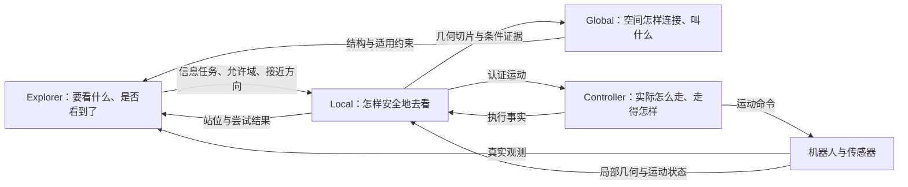

# 矿洞探索框架：对外讲解与设计评审简版

版本：v1.1，2026-10-08。同步蓝图 v1.2 的空间、时序与安全边界。本文解释重构的目标架构，不将目标能力写成已经完成的实现。详细规则、代码落点与待决项见 [设计蓝图](CONTRACT_STACK_BLUEPRINT_ZH.md)。

## 1. 一句话说明这套系统

机器人需要在部分未知的环境中，持续、安全地获得新空间的信息。Explorer 决定要获得什么，以及是否已经获得；Global 保存空间怎样连接、这些连接叫什么；Local 决定当前怎样安全地去获得；Controller 执行具体运动并报告真实结果。

因此，一个探索任务不是“必须走到这个坐标”，而是“沿这个接近方向，在允许范围内找到可执行的观察方式，获得这一组信息”。坐标可以是建议站位，但到坐标不等于完成探索。

本文以四足机器人 Go2 在矿洞中的探索为例。现有代码已有观测任务、局部候选、运动验证、控制反馈和累积图等资产；重构重点是明确这些资产之间的职责，并退役重复解释与相互冲突的旧入口。

## 2. 为什么需要调整，而不只是再调几个阈值

原有困难不是单一的路径问题。全局路线可能贴近障碍，局部优化也可能停在刚好满足余量的位置；真实步态的低速死区、转向能力和停车延迟进一步放大问题。机器人进入频繁减速、停车和恢复，之后又可能在相似失败方案之间重复尝试。

另一类问题发生在接口上：全局用观测进度判断任务，局部用到站和轨迹进度判断运动，两侧却把结果混成同一种“完成/堵住”。于是一次路径失败可能被解释成区域不可观察，一次到站可能被误解成任务满足，或者双方等待对方先清状态，造成卡住与奇怪短移。

重构要同时做两件事。路径端要提高几何和运动质量，主动远离不必要的贴边与多次转弯；接口端要让不同结果各归其主，不再让每个模块都猜“整个任务走到哪了”。新协议不能替代高质量路径，高质量路径也不能替代正确的取消、安全和交接。

## 3. 四个角色怎样合作

Explorer 持有完整信息目标和真实观测证据。它选择接近通道、允许范围和建议站位，发布任务；也由它根据新的实际观测决定任务是否满足。Local 不另记“已经看过哪些目标格”的完成账。

Global 提供可复用的空间连接、稳定身份，以及有条件的失败经验。它的几何原料来自 Local 的地图切片，不是仅根据机器人走过的路线画图。Explorer 读取结构副本，但不能把一次运动失败直接改成删边或删区域。

Local 在任务指定通道和允许范围内选择站位、搜索连接、生成形状受控的轨迹，并验证足迹、动力学、转向、制动和交接。粗路线是接近提示，不是必须逐点回接的轨道。局部自由也不是随意换到另一条分支。

Controller 收下经过验证的候选，按合法授权执行唯一活动运动，报告装载、实际活动、进度与结束原因。它不判断信息是否获得。Controller 是一个执行角色；当前 ROS 部署仍可通过消息连接，不要求与 Local 合成一个进程。

图画的是职责关系，不要求每条箭头新增一个 Topic。现有消息的关联和实际活动确认仍需按蓝图补齐。

三种地图也是不同职责：Explorer 的证据地图回答“看到了什么”，Global 的结构回答“怎样连接”，Local 的细粒度执行地图回答“当前状态下能否安全运动”。这些答案不能互相替代；粗图上连通不代表四足此刻可以直接通过。

## 4. 用一个任务把正常运行讲清楚

机器人前方有转角，转角后的空间尚未看清。Explorer 建立任务 G1：获得这一组目标信息，并给出接近通道和允许观察范围。

Local 根据当前地图选择站位 S1，建立一轮接近尝试 A1。在 A1 中，它可以生成多个候选，但只有通过统一验证的候选能交给 Controller。Controller 收下后，切换时还要确认机器人当前状态适合接续；实际活动后才开始按新运动走。

机器人运动过程中，真实观测持续进入 Explorer。这时有两种正常顺序。第一种是机器人还没走完轨迹，G1 的信息已经获得；Explorer 可以准备交接 G2。第二种是机器人已经到 S1，信息仍不足；Explorer 决定有期限地观察，或批准另一站位尝试。Local 不因为 G1 还活动就自行无限补短轨迹。

这就是“完成度分离”的含义：信息是否获得只有一份账，运动是否完成另有事实。不是让两边各算一个任务完成率再对账。异步事实需要关联，但不需要两个模块对同一个观测结论各下判断。

## 5. 为什么要区分任务、尝试、候选和轨迹

G1 任务表达“要获得什么信息”，可能持续多个站位。A1 尝试表达“这一轮怎么接近”，可能包含多个候选。候选是一份尚未实际活动的方案；轨迹是受执行侧管理的具体运动版本。请求只是一次提交与响应关系，不等于其中任何一个任务。

G1 满足以后不再开新的 G1 运动目的，但旧安全轨迹可以在交接政策允许的有限范围内继续。A1 穷尽以后不能再生候选，但 G1 的需求可能仍在。候选接受以后不等于机器人已切换；机器人收到 HOLD 也不等于已经停稳。

这些区分不是为了增加状态机数量，而是避免一个 BLOCKED 或 FINISHED 同时改变多个不相干对象。对应对象只保存自己需要的有限状态，具体生命周期见蓝图 [3.6—3.15](CONTRACT_STACK_BLUEPRINT_ZH.md#lifecycles)。

## 6. 第一次路径被否以后，下一次必须真的不同

假设 Local 的候选在起步转向段不安全。系统首先说明失败发生在什么位置、什么方向、什么运动合同下。当前活动运动仍安全时，可保留它并后台换方案；当前运动不安全时，立即停车，不等全局确认。

下一次重规划要针对原因改动：起步失败改初始连接，中段障碍改绕行形态，站位不合适改等效观察站位，运动能力不足改到已认证的合同。仅把目标挪远、样条偏移几厘米或重新发编号，而失败的出发段不变，不算有效新方案。

Local 的一轮尝试有候选和时间预算，Explorer 对跨轮调整也有外层预算。新请求、轨迹 ACK 或无关地图更新不能刷新预算。本轮穷尽后，反馈的是“这轮运动没有得到可执行方案”，不是“整个区域无法观察”。Explorer 保留需求，重估有意义的接近方案，或调度其他任务。

如果唯一窄通道中确实没有任何经认证的起步，系统不能保证机器人总能继续动。正确出口是明确说明仍缺哪些信息、为什么受限、已经试过什么、什么变化能触发重查，以及何时需要其他策略或人工处理。不能永久静默等待，也不能为了不停车而放行未知空间。

## 7. 失败经验怎样进入“渔网”，又不误删通道

渔网指 Global 维护的空间连接表示，不默认要求三角剖分。TRG 的邻近连接可以形成三角环，但不证明三角形内部任意位置都可走；是否需要面片由实际区域与细化需求决定。几何证据决定连接结构；运动失败决定在什么条件下限制某种走法。两者分开保存。

例如，“沿此方向、用当前转向合同无法从墙旁起步”可以成为有范围的约束，但不直接删掉矿道连接。Explorer 可立即使用有效的待确认证据，Global 随后确认保存；确认同一条证据不能再计一次失败。证据在新 Goal 下仍可能有效，不随任务结束消失。

当长边被细分，失败证据按世界范围和方向重新挂到实际重叠部分，不扩大成所有子边禁行。撤销也依据证据自己的条件，而不是因为别处来了新点云。重复失败可以提示这里值得检查，但只有新鲜几何与诊断支持“粗表示漏了实际连接”时，才请求有预算的局部细化。

因此，失败经验既能减少换汤不换药的重试，又不能把执行能力问题伪装为空间事实。这里的稳定分支身份、完整条件证据和确认快路径仍是待落地的重要能力。

没走过不等于没看见：已观测地面可以产生候选连接，未经执行则缺少通行经验；完全未知处不提前认证地面。地面摘要推荐由感知侧与投影同源生成，距离场须说明到原始障碍、非自由区域还是膨胀边界的距离。Global 的空间区域、Explorer 的目标范围与承诺独立，区域细分不自动换任务或释放承诺。详见蓝图 3.12a、8.2—8.5。

返航复用同一图及适用约束，Home 是稳定目标。去程经验不代替反向认证；路线倒序只是候选。预算与返程估价未经标定时不声称保证可返航，详见蓝图 8.6/Q15。

## 8. G1 到 G2 怎样保持连续，而不靠盲目续走

Explorer 可以提前准备 G2 建议，但准备不改变当前承诺，也不给 G2 执行权。G1 的真实信息满足后，Explorer 复查建议仍有效，正式提交 G2，不再要求 Local 先走到站位或停车。

Local 为 G2 生成候选，Controller 收下；此时旧安全轨迹仍可以有界继续。真正切换前，从当前实测状态复验接续。成立才原子转移唯一活动授权；旧运动写“被替换”的结果，临时交接状态随后回收。若旧运动先变危险，安全停止立即优先。

连续性来自“提前准备、及时提交、安全接续”，不是删除 HOLD，更不是默认收到候选就已经切换。评价连续性要分别测“信息满足到 G2 发布”和“G2 发布到实际活动”，不能只看 RViz 路线刷新。

## 9. 边缘设备上的效率与后续 RL 接入

架构希望保留增量结构、稳定身份和变化范围，减少全量计算；候选数量、等待、历史缓存和细化都有预算。地图没相关变化时可以跳过重算，但取消、健康、超时和到站观察仍处理。模块更新可以异步，不要求所有定时器机械同步。

这些设计提供降低计算浪费的条件，不直接证明部署后省了多少 CPU。仍需分阶段耗时、队列年龄、内存和同场景行为对照。增量渔网引擎与任务生命周期宜分阶段替换，便于归因。

异步不意味着随意混用版本。一次计算读取固定上下文，提交时复查真实依赖；别处更新不让所有方案作废，相关新危险也不能因结构滞后被忽略。最新图消息不刷新每条旧连接的观测年龄。详见蓝图 10.5—10.6。

统一安全不只是统一一个阈值：机器人尺寸与同源误差不能重复扣除，软居中偏好不伪装成硬障碍，制动与转向采用运动相关扫掠。域、形状及 RL 能力限制各报自己的原因，详见蓝图 5.2。

未来 RL 可以进入 Local 的站位或运动候选生成接口，也可以给出候选评分，但输出仍要遵守允许域、认证运动能力和安全仲裁。RL 不接管真实观测完成账，也不能让一次低置信度预测永久封区域。训练与泛化效果需要单独实验，不由接口设计自动解决。

## 10. 请评审者重点判断什么

以下问题用于架构评审，不预设答案。具体规则仍以蓝图为准。

| 评审问题 | 为什么关键 | 详细入口 |
|---|---|---|
| 信息获得的判据能否排除暂时消失和配准错误？ | 否则任务会错误关闭，或墙后产生假需求 | [E0/E3](CONTRACT_STACK_BLUEPRINT_ZH.md#explorer)、Q1/Q4 |
| 允许域和有方向的通道约束是否既给自由又防串路？ | 过紧重复回接，过宽导致局部漫游 | [L1](CONTRACT_STACK_BLUEPRINT_ZH.md#l1)/E2、Q6 |
| 路径质量与运动认证是否覆盖贴边、短段乱转、死区和停车？ | 只改接口不能解决运动源头 | [L2/L3/C2](CONTRACT_STACK_BLUEPRINT_ZH.md#local)、Q7/Q8 |
| 重试能否证明改变了失败假设，并有内外层出口？ | 否则编号在变，但系统没有有效新方案 | [F1—F4](CONTRACT_STACK_BLUEPRINT_ZH.md#failure)、Q3/Q11 |
| 装载、实际活动、取消和旧运动退役是否完整关联？ | 否则会长停顿、旧授权复活或多个命令源 | [H1—H4](CONTRACT_STACK_BLUEPRINT_ZH.md#handoff)/X1—X3、Q9/Q10 |
| 证据范围、撤销、身份迁移及计算预算是否可控？ | 否则约束越记越多，图越细越难解释 | [N1—N3/G2/G3](CONTRACT_STACK_BLUEPRINT_ZH.md#net)、Q12—Q14 |

结构清晰不等于收益已经成立。应以同场景对照检验任务交接延迟、有效新信息、重复失败比例、路径质量、安全停车原因和计算开销。不能把“对账减半”“不会再卡住”或“总能找到路”当成既定结论。

## 11. 对外讲解时可以直接这样收尾

我们的系统把“获得信息”和“执行运动”分开，但没有复制两份信息账。Explorer 唯一判断观测任务是否满足；Global 提供持久空间连接和有条件的经验；Local 在指定通道内自主生成并认证具体走法；Controller 报告真实执行。路径失败先纠正路径或站位，不自动否决整个区域。正常任务交接提前准备并安全接续，危险运动随时优先停止。

重构的目标不是加一套更厚的对账协议，而是让每个结果只结束正确的对象，并让下一次尝试能够解释自己为什么不同。路径质量、真实动力学和感知可靠性仍需分别改进与验证。

如果评审者对某一点有疑问，请直接回到 [详细蓝图](CONTRACT_STACK_BLUEPRINT_ZH.md) 对应卡片提出反例。简版用于建立认知和评价架构，蓝图用于冻结输入输出、生命周期、退出条件和验收。
